# Réseau · Graphe — components

Design interview material for the network graph. **Documentation only**: nothing here is
implemented, and nothing here changes the Figma file.

- **File**: `S7IvC6GvlcUFe5IgbtvQq6` (« Nouveau récits »), section `Réseau · Graphe` (`512:15486`), page
  `Screens` (`20:4`). The segmented control's main component lives on page `Screens · Components` (`20:3`).
- **Read on** 2026-10-13, through `get_design_context` plus a read-only Plugin API dump of every node (fills,
  strokes, dash patterns, radii, bound variables, effect and text styles). Every value below comes from that dump,
  not from the screenshots.
- **Spec panel** `Spec · Réseau en graphe` (`515:16039`) calls all six `Graph / …` components and the segmented
  control **local, not to be published**, and claims **« Aucun token nouveau »**. That holds for colours: every
  fill and stroke is bound to an existing variable. It does not hold for sizes, stroke widths, dash patterns,
  opacities and one font size — see [Values with no Swift token](#values-with-no-swift-token).
- **Light mode only** (the spec says « Mode clair seul »). Every colour is a semantic token, so dark mode resolves
  by itself, except the shadows (see the last table).
- **Code Connect**: `get_code_connect_map` was called on `512:16006`, `512:16016`, `512:16061`, `519:16390`,
  `519:16401`, `521:15969`, `518:510`, `498:14383`, `22:14` and `522:16586`. Every call was refused: « You need a
  Dev or Full seat on an Organization or Enterprise plan to use Code Connect ». **No mapping could be read.** The file's own convention
  puts the Swift source in each component's description instead (quoted below where there is one).

Screenshots (all under `docs/grill-me/design/screenshots/`): `component-graph-me.png`, `component-graph-friend.png`,
`component-graph-group.png`, `component-graph-group@2x.png`, `component-graph-friend-dot.png`,
`component-graph-group-compact.png`, `component-graph-zoom-controls.png`, `component-graph-zoom-controls@4x.png`,
`component-segmented-control-3.png`, `component-cell-invitation.png`, `component-cell-group-invitation.png`,
`component-cell-group.png`, `element-r2-sheet-groupe.png`, `element-r4-minicarte.png`.

---

## Token legend

Every colour used by the components below, with the Figma variable path, the light value, and the Swift symbol
(`DesignSystem.Color`, `ReCIT_iOS/DesignSystem/Tokens/Color.swift`).

| Figma variable | Light | Swift |
|---|---|---|
| `background/default` | `#FFFFFF` | `.backgroundDefault` |
| `background/secondary` | `#F1F1F1` | `.backgroundSecondary` |
| `background/disable` | `#E8ECE6` | `.backgroundDisable` |
| `background/tinted` | `#F2FAE9` | `.backgroundTinted` |
| `background/tinted-inverse` | `#3A5A40` | `.backgroundTintedInverse` |
| `foreground/default` | `#191919` | `.foregroundDefault` |
| `foreground/secondary` | black 50 % | `.foregroundSecondary` |
| `foreground/inverse` | `#F1F1F1` | `.foregroundInverse` |
| `foreground/tinted` | `#558154` | `.foregroundTinted` (same Swift `case` as `.borderTinted`) |
| `foreground/tinted-inverse` | `#F2FAE9` | `.foregroundTintedInverse` |
| `border/default` | black 10 % | `.borderDefault` |
| `border/tinted` | `#558154` | `.borderTinted` |

Text styles (`DesignSystem.TextStyle`, `ReCIT_iOS/DesignSystem/Tokens/TextStyle.swift`). All have **auto line
height** and **0 letter spacing** in Figma. The Swift side scales them with Dynamic Type, which Figma cannot show.

| Figma text style | Font | Swift |
|---|---|---|
| `Title/title50` | Open Sans ExtraBold 18 | `.title50` |
| `Content/content400Bold` | Alegreya Bold 19 | `.content400Bold` |
| `Content/content300` | Alegreya Medium 17 | `.content300` |
| `Footnote/footnote200` | Alegreya Regular 12 | `.footnote200` |
| `Footnote/footnote200Bold` | Alegreya Bold 12 | `.footnote200Bold` |
| `Action/action300` | Open Sans SemiBold 17 | `.action300` |
| `Action/action200` | Open Sans SemiBold 12 | `.action200` |
| `Caption/caption200` | Open Sans Regular 12 | `.caption200` |

Effect styles.

| Figma effect style | Value in the file | Swift |
|---|---|---|
| `Shadow/Light` | drop shadow, black 18 % (`shadow/light`), offset (0, 2), blur 3, spread 0 | `.shadow(.light)` → `DesignSystem.Shadow.light` (`Tokens/Shadow.swift`) |
| `Shadow/Thumbnail` | drop shadow, black 10 % (`shadow/soft`), offset (0, 0), **blur 4** | no token — `CellThumbnail` writes `.shadow(color: .black.opacity(0.1), radius: 2)` (`Features/Components/CellThumbnail.swift:71`). The library doc's table still says blur 2: the file now says 4 |

Spacing tokens met below: `spacing/xx-small` 2 → `.xxSmall`, `spacing/x-small` 4 → `.xSmall`, `spacing/small` 8 →
`.small`, `spacing/s-medium` 12 → `.sMedium`, `spacing/medium` 16 → `.medium`, `spacing/large` 24 → `.large`.
Radius tokens: `radius/minimal` 4 → `.minimal`, `radius/medium` 8 → `.medium`, `radius/rounded` 12 → `.rounded`,
`radius/rounded-large` 24 → `.roundedLarge`, `radius/full` 360 → `.full`.

**About sizes in Figma auto-layout.** Several components have `strokesIncludedInLayout` on, so an inside stroke
adds to the hugged size: `Graph / Group` is 50 tall for 8 + 32 + 8 of content (+1 stroke each side), its `Invited`
variant 51 (1.5 each side), `Graph / Zoom Controls` 46 wide for 44-wide rows. In SwiftUI a `strokeBorder` overlay
does not change the frame, so take the **content** sizes, not the hugged ones.

---

## 1. `Graph / Me` — `512:16006`

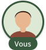

The signed-in user at the centre of the graph.

- **Type**: single `COMPONENT`, no variants, **no component properties** (no `Initials`, no `Show photo`).
- **Size**: 72 × 84 (hug).

Anatomy (vertical auto-layout, centred, **gap −10**: the label overlaps the bottom of the avatar by 10 pt):

| Layer | Node | Spec |
|---|---|---|
| `avatar` | `519:16387` | 72 × 72 frame, radius 36 (a circle), clips content. Fill `background/default`. Stroke **3 pt inside**, `background/tinted-inverse` (`#3A5A40`). Effect `Shadow/Light`. |
| `avatar › photo` | `519:16278` | Ellipse 72 × 72, absolute, image fill (scale mode FILL). The 3 pt ring is painted over its edge (a frame's stroke draws above its children). |
| `label` | `519:16388` | Horizontal auto-layout, hug (49 × 22), padding **3 / 10 / 3 / 10** (top/right/bottom/left), radius 360 (literal, the value of `radius/full`), fill `background/tinted-inverse`. |
| `label › Vous` | `519:16389` | « Vous », `Action/action200`, `foreground/inverse` (`#F1F1F1`). |

Uses on the screens: R1 / R2 at full size; R3 (dezoomed) **scaled to 70 %** — instance `520:16067`, 50.4 × 58.6,
opacity 1. The spec's « « Vous » à 70 % » is a **size**, not an opacity. In the R4 minimap it is scaled to ~17 %.

Fallback: **none drawn**. The component has no initials layer and no property to hide the photo, so the design
does not say what « Vous » looks like for an account without a picture (open point).

Closest existing SwiftUI:
- Image loading: `CachedAsyncImage` (`ReCIT_iOS/Features/Components/CachedAsyncImage.swift`) — renders nothing on
  failure, so anything layered under it shows through, which is how the Figma layers are stacked.
- `CellThumbnail` (`ReCIT_iOS/Features/Components/CellThumbnail.swift`) is the avatar used everywhere else
  (`UserCellView`, `UserHeaderView` with `.large` = 64). It cannot express this node as is: it paints
  `backgroundDisable` + a `ProgressView` while loading, a 10 % / radius 2 shadow instead of `Shadow/Light`, no
  ring, and `ThumbnailSize` has no 72.
- The « Vous » capsule has no existing counterpart. `TagLabelStyle` (`DesignSystem/LabelStyles/TagLabelStyle.swift`)
  is the nearest small label, but it is a radius-4 rectangle with 4 / 8 padding on `backgroundTinted`.

---

## 2. `Graph / Friend` — component set `512:16016`

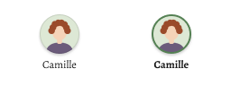

A friend, as a full node (R1, R2, R4).

| Property | Type | Default |
|---|---|---|
| `State` | variant | `Default` ∈ {`Default`, `Highlighted`} |
| `Name#512:0` | text | « Camille » |
| `Initials#512:3` | text | « CA » |
| `Show photo#519:0` | boolean | `true` |

Variants: `State=Default` `512:16008`, `State=Highlighted` `512:16012`. Both 100 × 64: a **fixed 100-wide** vertical
auto-layout, children centred, gap **4** (literal, the value of `spacing/x-small`).

| Layer | `Default` | `Highlighted` |
|---|---|---|
| `avatar` (frame 44 × 44, radius 22, clips) | fill `background/default`; stroke **1 pt inside** `border/default` | fill `background/tinted`; stroke **2 pt inside** `foreground/tinted` (`#558154`) |
| `avatar` effect | `Shadow/Light` | `Shadow/Light` |
| `avatar › initials` | « CA », `Action/action300` (Open Sans SemiBold 17), `foreground/tinted`, centred | same |
| `avatar › photo` | ellipse 44 × 44, absolute, image fill; visibility bound to `Show photo` | same |
| `name` | « Camille », `Footnote/footnote200` (Alegreya **Regular** 12), `foreground/default` | `Footnote/footnote200Bold` (Alegreya **Bold** 12), `foreground/default` |

**Fallback rule (initials).** The photo sits on top of the initials; with `Show photo` off (Nora, Paul in R1;
Jade in R4) the initials show on the avatar fill. The mock-ups take the **first two letters of the name,
uppercased, accents kept**: Inès → « IN », Léa → « LÉ », Rémi → « RÉ », Nora → « NO », Paul → « PA », and in R3
Aïcha → « AÏ », Élise → « ÉL », Hélène → « HÉ ». Not first-name + last-name initials (open point: inventaire.io
usernames are handles).

**Dimming (R2).** Nodes outside the touched group are the `Default` variant with **instance opacity 0.3**; there
is no `Dimmed` variant. The four friends of the touched group are `Highlighted`.

**Width.** The node is fixed at 100 and the name is `whitespace-nowrap` (hug): a name wider than 100 overflows the
node in Figma. Nothing says whether to truncate (open point).

Closest existing SwiftUI: same as `Graph / Me` — `CachedAsyncImage` over a `Text(initials)`, ring as an
`overlay(Circle().strokeBorder(…))`, `.shadow(.light)`. `UserCellView` (`ReCIT_iOS/Features/Community/UserCellView.swift`)
holds the data mapping (`user.username`, `user.avatarURLValue`) but not the layout.

---

## 3. `Graph / Group` — component set `512:16061`

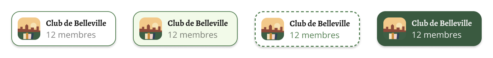

A group the user belongs to or is invited into, as a full node (R1, R2, R4).

| Property | Type | Default |
|---|---|---|
| `Role` | variant | `Member` ∈ {`Member`, `Admin`, `Invited`} |
| `State` | variant | `Default` ∈ {`Default`, `Highlighted`} |
| `Name#512:6` | text | « Club de Belleville » |
| `Detail#512:11` | text | « 12 membres » |
| `Show picture#519:3` | boolean | `true` |

**Only four of the six combinations exist**: `Role=Member, State=Default` `512:16017`, `Role=Admin, State=Default`
`512:16028`, `Role=Invited, State=Default` `512:16039`, `Role=Admin, State=Highlighted` `512:16050`. There is no
`Member · Highlighted` and no `Invited · Highlighted` (open point: touching a member group or an invitation).

Shared anatomy: horizontal auto-layout, hug (148 × 50 with the default strings), padding **8 / 12 / 8 / 8**
(`spacing/small` top/bottom/left, `spacing/s-medium` right), gap 8 (`spacing/small`), corner radius 12
(`radius/rounded`), effect `Shadow/Light`, children vertically centred.

| Layer | Spec |
|---|---|
| `tile` | 32 × 32 frame, radius **8** (literal — the value of `radius/medium`, not bound), clips content |
| `tile › Icon` | `Icon / Glyph=person.2` (`498:378`), 24 × 24, strokes 1.8 pt round-capped, `foreground/default` (`#191919`) in every variant — never recoloured |
| `tile › picture` | rectangle 32 × 32, absolute, image fill FILL, visibility bound to `Show picture`; clipped by the tile's radius 8 |
| `text` | vertical auto-layout, gap 0, clips |
| `text › name` | `Footnote/footnote200Bold` (Alegreya Bold 12) |
| `text › detail` | `Caption/caption200` (Open Sans Regular 12) |

Per variant:

| Variant | Container fill | Container stroke | Tile fill | Name | Detail |
|---|---|---|---|---|---|
| `Member · Default` | `background/default` | 1 pt inside, `border/tinted` | `background/tinted` | `foreground/default` | `foreground/secondary` |
| `Admin · Default` | `background/tinted` | 1 pt inside, `border/tinted` | `background/default` | `foreground/default` | `foreground/secondary` |
| `Invited · Default` | `background/default` | **1.5 pt inside, `foreground/tinted`, dashed `[4, 3]`** | `background/tinted` | `foreground/default` | **`foreground/tinted`** |
| `Admin · Highlighted` | `background/tinted-inverse` | 1 pt inside, `background/tinted-inverse` | `background/default` | `foreground/inverse` | `foreground/inverse` |

**`Detail` strings on the screens** — the role is spelled out in the detail, not only in the styling:

| Where | Role | Detail |
|---|---|---|
| R1 `513:15830` | Admin | « Admin · 12 membres » |
| R1 `513:15841` | Member | « 48 membres » |
| R1 `513:15852` | Invited | « Invitation de Camille » (`Show picture` off) |
| R2 `514:16025` (highlighted) | Admin | « Admin · 12 membres » |
| R4 `522:16238`, `522:16250` | Member | « 9 membres · 6 amis », « 21 membres · 4 amis » |

So the zoomed-in node (R4) adds a friend count the overview (R1) does not have (open point).

**Fallback rule (no picture).** `Show picture` off reveals the `person.2` glyph on the tile fill (Lecteurs du 11e in
R1/R2). Dimming in R2 is **instance opacity 0.3** on `Default` variants, as for friends.

Closest existing SwiftUI:
- `GroupCellView` (`ReCIT_iOS/Features/Network/Groups/GroupCellView.swift`) — same data (`ReaderGroup.name`,
  `.pictureURL`, `memberCount` through `groups.members_count`), but a list layout: 48 pt `CellThumbnail`,
  `content400Bold` / `content300`, plus `PendingDot`.
- `GroupRoleTag` (`ReCIT_iOS/Features/Network/Groups/GroupRoleTag.swift`) and `ReaderGroup.role(of:)`
  (`ReCIT_iOS/Model/Groups/ReaderGroup.swift`) — the role source; the graph renders role as styling + detail
  text, not as a tag.
- « Invitation de Camille » already exists as `groups.invited_by %@` (used by `GroupInvitationRowView`).
- The `person.2` fallback glyph is already the group glyph of the app (`EmptyStateView(glyph: "person.2")` in
  `GroupsSegmentView`, `GroupHeaderView`).

---

## 4. `Graph / Friend · Dot` — `519:16390`

A friend in the dezoomed overview (R3): 24 pt, no name. The spec: « les amis deviennent des pastilles de 24 pt
sans nom ».

| Property | Type | Default |
|---|---|---|
| `Show photo#519:8` | boolean | `true` |
| `Initials#519:9` | text | « NO » |

| Layer | Spec |
|---|---|
| root | 24 × 24 frame, radius 12 (a circle), clips. Fill `background/tinted`. Stroke 1 pt inside, `border/default`. **No shadow.** |
| `initials` | « NO », **Open Sans Regular 9**, `foreground/tinted`. Family bound to `font/family/sans`; the size is a literal and **no text style is applied** — no Swift `TextStyle` has 9 pt |
| `photo` | ellipse 24 × 24, absolute, image fill, visibility bound to `Show photo` |

Fallback: initials on `background/tinted` (R3: Chloé, Lucas, Sarah, Nathan, Jade, Adam, Noé, Mila, Eva, Maya).
Note the fill differs from `Graph / Friend · Default` (which is `background/default`).

In the R4 minimap the same component is scaled to ~5.86 pt (`522:16153` …).

Closest existing SwiftUI: `ThumbnailSize.xsmall` is 24 (`CellThumbnail.swift`), but it has no call site and the
same loading/shadow caveats as above.

---

## 5. `Graph / Group · Compact` — `519:16401`

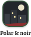

A group in the dezoomed overview (R3). The spec: « les groupes des tuiles de 52 pt avec leur nom ».

| Property | Type | Default |
|---|---|---|
| `Show picture#519:10` | boolean | `true` |
| `Name#519:11` | text | « Polar & noir » |

Vertical auto-layout, hug (61 × 72 with the default name), children centred, gap 4 (literal).

| Layer | Spec |
|---|---|
| `tile` | 52 × 52, radius **14** (literal, no token), clips. Fill `background/tinted`. Stroke **2 pt inside** `background/tinted-inverse` (`#3A5A40`). Effect `Shadow/Light` |
| `tile › Icon` | `Icon / Glyph=person.2`, 24 × 24, `foreground/default` |
| `tile › picture` | rectangle 52 × 52, absolute, image fill FILL, visibility bound to `Show picture`; the 2 pt ring draws over it |
| `name` | `Footnote/footnote200Bold`, `foreground/default`, no wrap |

**No role and no state.** In R3 the invited group (Lecteurs du 11e, `520:16037`, `Show picture` off) looks
exactly like a member group; only its dashed edge to « Vous » says it is an invitation. Admin / member is not
distinguished either (open point).

Closest existing SwiftUI: none. The 52 tile and 14 radius have no counterpart.

---

## 6. `Graph / Zoom Controls` — `521:15969`

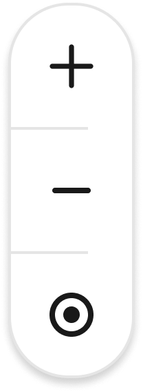

Description in Figma: « Zoom du graphe Réseau · Tout : +, −, recentrer sur « Vous ». Le pincement reste le geste
principal. »

- **Type**: single `COMPONENT`, no properties. Placed bottom-right at x 331, y 725 of R3 and R4 (16 from the right
  edge, 16 above the tab bar).
- **Container**: vertical auto-layout, 46 × 136 (44-wide rows + 1 pt stroke each side), radius 22 (a capsule),
  fill `background/default`, stroke 1 pt inside `border/default`, effect `Shadow/Light`.

| Row | Node | Content | Looks like (SF Symbol) |
|---|---|---|---|
| `zoom in` | `521:15970` | 44 × 44, `Icon / Glyph=plus` (`21:22`) 24 pt; its vector is a 14 × 14 cross, stroke 1.8 pt round caps, `foreground/default` | `plus` |
| `separator` | `521:15974` | rectangle **28 × 1**, `border/default` | — |
| `zoom out` | `521:15975` | 44 × 44, a rectangle 14 × 2, radius 1, fill `foreground/default` (drawn, not an `Icon`) | `minus` |
| `separator` | `521:15977` | rectangle 28 × 1, `border/default` | — |
| `recentrer` | `521:15978` | 44 × 44, a 16 × 16 ring (stroke 2 pt inside, `foreground/default`) + a 6 × 6 filled dot, centred | `smallcircle.filled.circle` (closest shape); `scope` or `location` would be the semantic alternatives |

**Defect in the file**: the two separators sit at x = 1, left-aligned (the container's counter-axis alignment is
MIN), so they run 1 → 29 inside a 46-wide capsule instead of being centred. Visible in the 4× render. Treat as
centred (or inset 8 each side) unless told otherwise.

Each row is a 44 × 44 tap target. The project rule « Buttons with an image must also carry text » applies:
Figma draws no labels (open point for the wording).

Closest existing SwiftUI: `CircularIconButtonStyle` (`ReCIT_iOS/DesignSystem/ButtonStyles/CircularIconButtonStyle.swift`)
is the only icon-button style — a 56 pt `backgroundTinted` circle, not a stacked white capsule. Nothing to reuse
as is.

---

## 7. `Chrome / Segmented Control · 3` — component set `518:510`

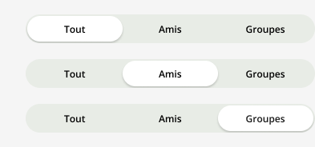

On page `Screens · Components` (`20:3`). Description: « Trois segments : Tout | Amis | Groupes de l'onglet Réseau
(proposition Réseau · Graphe). »

| Property | Type | Default |
|---|---|---|
| `Selected` | variant | `Left` ∈ {`Left`, `Middle`, `Right`} |
| `Left label#518:0` | text | « Tout » |
| `Middle label#518:4` | text | « Amis » |
| `Right label#518:8` | text | « Groupes » |

Variants: `Selected=Left` `518:486` (R1–R4, instances `519:16411`, `519:16419`, `520:15801`, `522:16093`),
`Selected=Middle` `518:494` (R5, `522:16663`), `Selected=Right` `518:502` (R6, `522:16751`).

| Layer | Spec |
|---|---|
| root | 393 × 40 fixed, horizontal auto-layout, padding **8 / 16** (`spacing/small` / `spacing/medium`), no fill |
| `track` | fills the width (361), hugs 36 high, fill `background/disable` (`#E8ECE6`), radius `radius/full`, padding 2 (`spacing/xx-small`), clips |
| `segment/*` | three equal segments (each fills: 119 × 32), padding 8 (`spacing/small`), content centred, clips |
| selected segment | fill `background/default`, radius 360 (literal on the selected one, `radius/full` bound on unselected ones), effect `Shadow/Light`; label `foreground/default` |
| unselected segment | no fill; label `foreground/secondary` |
| labels | `Action/action200` (Open Sans SemiBold 12), centred |

Geometry note: the 36-high track sits in a 40-high frame with 8 pt top/bottom padding, so it overflows the padding
by 6 pt each side; on the screens the frame is placed at y 155–195 and the visible track spans y 157–193.

Placement: a **fixed bar** between the large navigation bar (ends at y 155) and the content (graph from y 195;
lists from y 211). On R1–R4 it sits on `background/default`, on R5/R6 on `background/secondary`.

Closest existing SwiftUI: `NetworkView` (`ReCIT_iOS/Features/Network/NetworkView.swift`) already has the control,
as a **native** `Picker(…).pickerStyle(.segmented)` over `NetworkSegment` (`ReCIT_iOS/Features/Network/NetworkSegment.swift`,
two cases `friends` / `groups`, strings `network.segment.friends` « Amis » and `network.segment.groups`
« Groupes »). Differences with the design:

1. Two segments, not three — « Tout » needs a case and a string (none exists).
2. The picker is the **first row of the `List`** (it scrolls, so the large title collapses — PRD 0016), while
   Figma pins it under the navigation bar; the graph cannot live inside a `List` row anyway.
3. The Figma control is a custom pill track (`background/disable` + white selected pill with `Shadow/Light`), not
   the system segmented control (which on iOS 26 renders its own glass style). Open point: native or custom.

---

## 8. List components in R5 (`522:16586`) and R6 (`522:16671`)

The spec: « Amis (R5) et Groupes (R6) sont les listes de la feature 0028, inchangées sauf photos. » Every row
below is an instance of an existing component from `Screens · Components`; none is new.

**List layout** (both frames): background `background/secondary`; content starts at y 211 (16 below the segmented
control); sections stacked with gap 24 (`spacing/large`); inside a section, header → card gap 4 (`spacing/x-small`);
each card (`list group`) is 361 wide (16 inset each side), fill `background/default`, radius `radius/medium` (8),
clips. This is what `List` inset-grouped + `.applyListBackground()` (`ReCIT_iOS/DesignSystem/List/View+applyBackground.swift`)
already draws.

Instance inventory:

| Instance | Node | Main component | Props |
|---|---|---|---|
| R5 header | `522:16589` | `Section Header` `28:164` | Label « Invitations » |
| R5 invitation | `522:16591` | `Cell / Invitation` `405:374` | Username « Ariane », Item count « 6 livres » |
| R5 separator | `522:16592`, `522:16598`, `522:16600`, `522:16602` | `Separator` `47:193` | — |
| R5 see all | `522:16593` | `Row / Link` `38:200`, `Tone=Tinted` `38:196` | « Toutes les invitations » |
| R5 header | `522:16595` | `Section Header` | « Amis » |
| R5 friends | `522:16597`, `522:16599`, `522:16601` | `Cell / User` `30:179` | Camille « 42 livres », Rémi « 17 livres », Inès « 63 livres » |
| R5 add friends | `522:16603` | `Row / Link` Tinted | « Ajouter des amis lecteurs » |
| R6 header | `522:16674` | `Section Header` | « Invitations » |
| R6 invitation | `522:16676` | `Cell / Group Invitation` `498:14384` | Name « Lecteurs du 11e », Detail « 31 membres · 912 livres », Invitor « Invitation de Camille » |
| R6 header | `522:16678` | `Section Header` | « Mes groupes » |
| R6 group | `522:16680` | `Cell / Group` `498:14383`, `State=Admin` `498:14346` | « Club de Belleville », « 12 membres · 340 livres » |
| R6 separator | `522:16681`, `522:16690` | `Separator` | — |
| R6 group | `522:16682` | `Cell / Group`, `State=Default` `498:14341` | « BD & romans graphiques », « 48 membres · 1 204 livres » |
| R6 header | `522:16684` | `Section Header` | « Demandes envoyées » |
| R6 sent | `522:16686` | `Cell / Group`, `State=Sent` `498:14357` | « Immeuble Ramponeau », « 6 membres » |
| R6 find | `522:16689` | `Row / Link` Tinted | « Trouver un groupe » |
| R6 create | `522:16691` | `Row / Link` Tinted | « Créer un groupe » |
| R2 sheet button | `514:16117` | `Button / Large` `22:14`, `Style=Primary, State=Default` `22:2` | « Ouvrir le groupe » |

Every one of these French strings except « Ouvrir le groupe » and the item counts already exists in
`Localizable.xcstrings` (`profile.invitations` / `groups.invitations`, `network.friends`, `groups.mine`,
`groups.requests.sent`, `network.invitations.all`, `network.add_friends`, `groups.find`, `groups.create`,
`network.invitation.accept`, `network.invitation.refuse`, `groups.role.admin`, `groups.request.sent`,
`groups.invited_by %@`).

### 8.1 `Section Header` — `28:164`

Props: `Label#28:0` (text), `Action label#206:0` (text, « Ajouter »), `Show action#206:1` (boolean, default
`false` — off on every R5/R6 instance).

Horizontal auto-layout, fills the width (393), hug height 24, padding **0 / 16 / 8 / 16** (`spacing/medium`
sides, `spacing/small` bottom), gap 8, baseline-aligned. Label `Action/action200`, `foreground/secondary`. The
hidden action is a 12 pt `plus` glyph + `Action/action200` in `foreground/tinted`, padding 8 vertical.

The component's description says the label is `foreground/default`; the node is bound to `foreground/secondary`.
The Network code uses `foregroundSecondary` (`header(_:)` in `GroupsSegmentView`, the inline header in
`FriendsSegmentView`), which matches the node. `ShelfSectionHeader` (`ReCIT_iOS/Features/Components/ShelfSectionHeader.swift`)
is the shared component and uses `foregroundDefault`.

### 8.2 `Cell / Invitation` — `405:374` (with `Action / Pill` `358:357`)

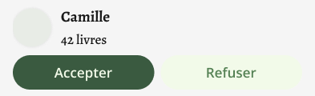

Props: `Username#30:3`, `Item count#30:4` (text). 393 × 120 (361 in the card).

- Root: vertical auto-layout, padding **8 / 16 / 8 / 16**, gap **8**.
- `user`: horizontal, gap 12, centred — `avatar` = `Thumbnail / Size=Medium, Shape=Round` (`28:159`), 48 × 48,
  radius `radius/full`, `Shadow/Thumbnail`; on R5 its fill is overridden by the image (`IMAGE FILL`); otherwise
  `background/disable`. `texts`: vertical, gap 4 (`spacing/x-small`) — Username `Content/content400Bold`, Item count
  `Content/content300`, both `foreground/default`.
- `actions`: horizontal, gap 8, two `Action / Pill` that each fill half (176.5 × 43 at 393; 160.5 at 361):
  `Style=Prominent` (`358:347`) « Accepter » — fill `background/tinted-inverse`, label `foreground/tinted-inverse`;
  `Style=Tinted` (`358:352`) « Refuser » — fill `background/tinted`, label `foreground/tinted`. Both padding
  **10 / 16**, gap 8, radius `radius/full`, label `Action/action300`, `Show glyph` off.

Existing SwiftUI: `InvitationRowView` (`ReCIT_iOS/Features/Community/InvitationRowView.swift`) with
`.buttonStyle(.pill(.prominent))` / `.pill()` from `PillButtonStyle` (`ReCIT_iOS/DesignSystem/ButtonStyles/PillButtonStyle.swift`).
Pre-existing differences: the code stacks with `.sMedium` (12) where Figma has 8, and the pill's vertical padding is
`.small` (8) where Figma has 10.

### 8.3 `Cell / User` — `30:179`

Props: `Username#30:3`, `Item count#30:4`. 393 × 69: horizontal, padding 8 / 16 (`spacing/small` /
`spacing/medium`), gap 12 (`spacing/s-medium`), top-aligned; avatar Thumbnail Medium / Round 48 (image fill on R5),
texts as in 8.2.

Existing SwiftUI: `UserCellView` (`ReCIT_iOS/Features/Community/UserCellView.swift`) via
`CellThumbnail(imageUrl: user.avatarURLValue, cornerRadius: .full, size: .medium)`. **The second line differs**:
Figma shows « 42 livres »; the code shows « Membre depuis … » (`user.member_since`) or, while a friend's first sync
runs, a progress bar and caption. The code's header comment explains why the item count was dropped.

### 8.4 `Row / Link` — `38:200`, `Tone=Tinted` `38:196`

Props: `Label#38:4` (text), `Tone` ∈ {`Tinted`, `Destructive`}. 393 × 47: horizontal, padding **12 / 16**
(`spacing/s-medium` / `spacing/medium`), gap 8; label `Action/action300`, `foreground/tinted`. No chevron in the
component (a `NavigationLink` in a `List` draws the system one).

Existing SwiftUI: no shared view — inline `Text(…).textStyle(.action300).foregroundStyle(.foregroundTinted)` inside a
`NavigationLink` / `Button` (`FriendsSegmentView`, `link(_:)` in `GroupsSegmentView`).

### 8.5 `Separator` — `47:193`

361 × 1, left padding 16 (`spacing/medium`); `hairline` rectangle 345 × 1, fill `border/default`, height bound to
`sizing/border/hairline` (1 → `Constant.borderWidth`, dead code per the library doc's D5).

Existing SwiftUI: the native `List` separator. `UserCellView` pins its leading inset with
`.alignmentGuide(.listRowSeparatorLeading)`.

### 8.6 `Cell / Group Invitation` — `498:14384`

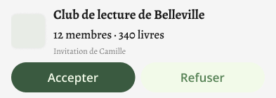

Props: `Name#498:8`, `Detail#498:9`, `Invitor#498:10` (text). 393 × 140.

- Root: vertical, padding 8 / 16, gap 8.
- `group`: horizontal, gap 12, centred — `picture` = `Thumbnail / Size=Medium, Shape=Medium` (`28:158`), 48 × 48,
  radius `radius/medium` (8), `Shadow/Thumbnail`, fill `background/disable` (no picture on R6: Lecteurs du 11e);
  `texts` vertical gap 4: Name `Content/content400Bold`, Detail `Content/content300` (both `foreground/default`),
  Invitor `Footnote/footnote200` `foreground/secondary`.
- `actions`: same two pills as 8.2.

Existing SwiftUI: `GroupInvitationRowView` (`ReCIT_iOS/Features/Network/Groups/GroupInvitationRowView.swift`), Invitor
through `groups.invited_by %@`.

### 8.7 `Cell / Group` — component set `498:14383` (with `Tag` `23:23`)

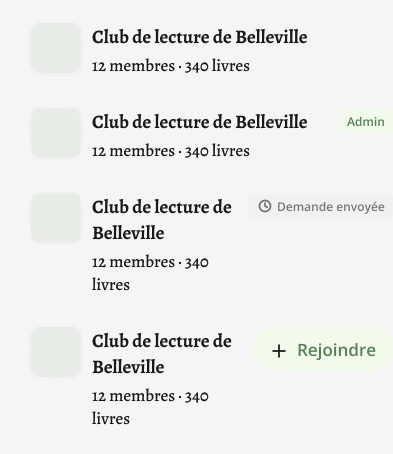

Props: `Name#498:6`, `Detail#498:7` (text), `State` ∈ {`Default` `498:14341`, `Admin` `498:14346`, `Sent`
`498:14357`, `Join` `498:14371`}.

Shared: horizontal, padding 8 / 16, gap 12, top-aligned; `picture` Thumbnail Medium / Medium 48, radius 8,
`Shadow/Thumbnail` (image fill on R6 for Club de Belleville and BD & romans graphiques; `background/disable` for
Immeuble Ramponeau); `texts` vertical gap 4, Name `Content/content400Bold`, Detail `Content/content300`.

| State | Trailing element |
|---|---|
| `Default` | none |
| `Admin` | `Tag / Color=Tinted` (`23:11`) « Admin », `Show glyph` **off** — fill `background/tinted`, label `foreground/tinted` |
| `Sent` | `Tag / Color=Secondary` (`23:17`) « Demande envoyée », glyph `Icon / Glyph=clock` (`21:59`) — fill `background/secondary`, label `foreground/secondary` |
| `Join` | `Action / Pill` Tinted « Rejoindre » with the `plus` glyph (not used in R6) |

`Tag` metrics: padding **4 / 8** (`spacing/x-small` / `spacing/small`), gap 4, radius `radius/minimal` (4), glyph 16
(`sizing/icon/tag`), label `Action/action200`.

Existing SwiftUI: `GroupRowView` (`ReCIT_iOS/Features/Network/Groups/GroupRowView.swift`) = `GroupCellView` +
`GroupRoleTag`, tags through `TagLabelStyle` (`.tag` / `.secondaryTag`). Pre-existing differences: the code's
Admin tag carries a `checkmark.seal` glyph (Figma: none); the code's detail is « N membres » only (Figma: « 12
membres · 340 livres »); the code puts a `PendingDot` after the name of a group with requests waiting.

### 8.8 `Button / Large` — `22:14` (in the R2 sheet)

Props: `Label#22:1`, `Style` ∈ {`Primary`, `Secondary`, `Destructive`}, `State` ∈ {`Default`, `Disabled`}. In R2:
`Style=Primary, State=Default` (`22:2`), « Ouvrir le groupe », filling the sheet's width (345 × 55). Padding
**16 / 24** (`spacing/medium` / `spacing/large`), radius `radius/full`, fill `background/tinted-inverse`, label
`Action/action300` `foreground/tinted-inverse`.

Existing SwiftUI: `.buttonStyle(.primary())` — `LargeButtonStyle` (`ReCIT_iOS/DesignSystem/ButtonStyles/LargeButtonStyle.swift`).

---

## 9. Graph elements that are not components

Drawn directly in the screen frames; listed here because building the components alone does not produce them.

### 9.1 Group sheet — `514:16113` (R2)

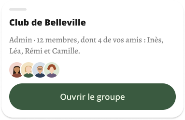

377 × 243 at x 8, y 626 (8 from each side, bottom 8 above the tab bar). Vertical auto-layout, padding 16, gap 12,
radius **24** (`radius/rounded-large`), fill `background/default`, effect `Shadow/Light`, clips.

| Child | Spec |
|---|---|
| grabber `514:16114` | 36 × 5, radius 3, fill `border/default` |
| title `514:16115` | « Club de Belleville », `Title/title50`, `foreground/default` |
| body `514:16116` | « Admin · 12 membres, dont 4 de vos amis : Inès, Léa, Rémi et Camille. », `Content/content300`, `foreground/secondary` |
| `amis en commun` `522:16837` | horizontal, **gap −8** (overlap), four ellipses 32 × 32, image fill, stroke **2 pt outside** `background/default` |
| button `514:16117` | `Button / Large` Primary « Ouvrir le groupe » |

It floats with side margins and rounded bottom corners, which is not the shape of a system `.sheet` with
detents (open point). The friend sheet (« Voir le profil ») is not drawn.

### 9.2 Counter — `521:15993` (R3, R4)

137 × 30 at x 16, y 831. Horizontal, padding **6 / 12**, radius 360, fill `background/default`, stroke 1 pt inside
`border/default`, `Shadow/Light`. Text « 42 amis · 7 groupes », `Action/action200`, `foreground/secondary`.

### 9.3 Minimap — `522:16302` (R4 only)

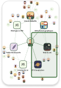

96 × 140 at x 281, y 207 (16 from the right, 12 under the segmented control). Radius 12 (`radius/rounded` value),
fill `background/default`, stroke 1 pt inside `border/default`, `Shadow/Light`, clips. Contains the whole graph
scaled to ~24 % (dots 5.86, `Graph / Me` 12.3 × 14.6, compact groups). Viewport `522:16303`: radius 3, fill
`foreground/tinted` at **12 %**, stroke **1.5 pt inside** `foreground/tinted`. The spec: « La minicarte
n'apparaît qu'une fois zoomé. »

### 9.4 Edges

Vectors, stroke only, `CENTER` alignment, no caps set.

| Screen | Edge kind | Stroke | Width | Dash | Node opacity |
|---|---|---|---|---|---|
| R1 | friend ↔ group, « Vous » ↔ group | `foreground/tinted` | 1.5 | — | 0.6 |
| R1 | « Vous » ↔ invited group | `foreground/tinted` | 1.5 | `[4, 4]` | 1 |
| R1 | « Vous » ↔ friend | `border/default` | 1 | — | 1 |
| R2 | edges of the touched group | `foreground/tinted` | **2.5** | — | 1 |
| R2 | every other edge | as R1 | as R1 | as R1 | **0.12** |
| R3 | « Vous » ↔ group | `foreground/tinted` | 2 | — (`[3, 3]` to the invited group) | 0.8 |
| R3 | friend ↔ group | `foreground/tinted` | 1 | — | 0.3 |
| R3 | « Vous » ↔ friend | none — the spec: « les arêtes vous ↔ ami disparaissent » | | | |
| R4 | « Vous » ↔ group (« Vous » off-screen) | `foreground/tinted` | 2 | — | 1 |
| R4 | friend ↔ group | `foreground/tinted` | 1.5 | — | 0.6 |
| R4 | « Vous » ↔ friend (off-screen) | `border/default` | 1.5 | — | 0.5 |

The spec text reads « ami ↔ groupe (foreground/tinted, 60 %), vous ↔ groupe, vous ↔ ami (border/default) »; the
nodes show « Vous » ↔ group drawn like friend ↔ group (tinted, 60 %), not `border/default`.

### 9.5 Navigation bar and background

R1–R4: frame fill `background/default`, and the `Chrome / Nav Bar` (`Style=Large`, `26:114`) fill overridden to
`background/default`. R5–R6: frame `background/secondary`, nav bar left at its literal `#F9F9F9` at 94 %.
The spec: « Le graphe est sur background/default (blanc), barre de navigation comprise ; les listes gardent
background/secondary sous leurs cartes blanches. » Title « Réseau » (`nav.network`), trailing `plus` action glyph.

---

## Values with no Swift token

Colours are all tokens. These are not:

| Value | Where | Nearest token / note |
|---|---|---|
| 72 pt avatar | `Graph / Me` | none (`ThumbnailSize`: 24 / 36 / 48 / 64) |
| 44 pt avatar | `Graph / Friend` | none |
| 32 pt tile | `Graph / Group`; 32 pt avatars in the sheet | none |
| 52 pt tile | `Graph / Group · Compact` | none |
| 24 pt dot | `Graph / Friend · Dot` | `ThumbnailSize.xsmall` (24) exists, unused |
| 100 pt node width | `Graph / Friend` | none |
| radius 14 | `Graph / Group · Compact` tile | none (scale is 4 / 8 / 12 / 24) |
| radius 8 unbound | `Graph / Group` tile | value of `radius/medium` → `.medium` |
| radius 3 | sheet grabber, minimap viewport | none |
| stroke 3 | `Graph / Me` ring | none (`sizing/border/hairline` = 1 only) |
| stroke 2 | highlighted friend, compact tile, sheet avatar ring, R3 edges | none |
| stroke 1.5 | invited group border, edges, minimap viewport | none |
| stroke 2.5 | lit edges (R2) | none |
| stroke 1 | default friend, dot, zoom controls, counter, minimap | `sizing/border/hairline` → `Constant.borderWidth` (dead code, D5) |
| dash `[4, 3]` | `Graph / Group` Invited border | none |
| dash `[4, 4]` / `[3, 3]` | invitation edge, R1–R2 / R3 | none |
| Open Sans Regular **9** | `Graph / Friend · Dot` initials | no `TextStyle` (smallest is 12) |
| padding 3 / 10 | « Vous » label | none (scale: 2, 4, 8, 12, 16, 24) |
| padding 6 / 12 | counter | 6 has no token |
| padding 10 / 16 | `Action / Pill` (existing component) | code uses `.small` (8) |
| gap −10 | `Graph / Me` overlap | none |
| gap −8 | common-friends avatars | none |
| gap 4 literal | `Graph / Friend`, `Graph / Group · Compact` | value of `spacing/x-small` → `.xSmall` |
| separator 28 × 1 | zoom controls | none |
| opacity 0.3 | dimmed nodes (R2) | none (`Opacity` collection: 92, 20) |
| opacity 0.12 | dimmed edges (R2) | none |
| opacity 0.6 / 0.8 / 0.5 / 0.3 | edges | none |
| 12 % fill | minimap viewport | none |
| scale 0.7 | « Vous » dezoomed | none |
| blur 4 | `Shadow/Thumbnail` in the file | code: radius 2 literal |

`Shadow/Light` is black 18 % in both modes (the library doc's D9): it is invisible on a dark background, and
every graph node, the zoom controls, the counter, the minimap, the sheet and the selected segment carry it.
