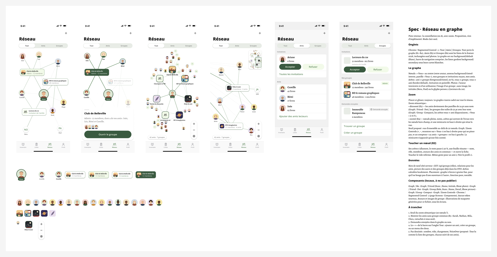

# Réseau · Graphe — design overview

The Réseau tab drawn as a graph: « Vous » in the middle, my groups and the group invitations I received
around me, my friends attached to the groups we share. A third segment, **Tout**, carries the graph; **Amis**
and **Groupes** keep the lists shipped in [feature 0028](../../features/0028-network-tab-and-groups.md).

- **Source:** [Figma — section `Réseau · Graphe`](https://www.figma.com/design/S7IvC6GvlcUFe5IgbtvQq6/Nouveau-r%C3%A9cits?node-id=512-15486)
  (`512:15486`, 3558 × 1804)
- **File key:** `S7IvC6GvlcUFe5IgbtvQq6` · **Page:** `Screens` (`20:4`); the segmented control lives on
  `Screens · Components`
- **Status (from the spec):** « Proposition, rien d'implémenté. Mode clair seul. »
- **Repo context:** Figma conventions and node history in
  [docs/design-system/figma-library.md](../../design-system/figma-library.md); the tab as built today is
  `ReCIT_iOS/Features/Network/NetworkView.swift` (native two-segment picker, `NetworkSegment.friends` /
  `.groups`).

## The other files

| File | What it holds |
|---|---|
| [tokens.md](tokens.md) | Colours (light / dark / Swift symbol), typography, spacing, radii, strokes and dashes, edge styles per screen, elevation, opacities, and every value with no Swift token |
| [components.md](components.md) | The seven local components, their variants, properties and anatomy |
| [assets.md](assets.md) | Image slots (avatars, group pictures), glyphs and fallbacks |
| [screens/r1-tout-constellation.md](screens/r1-tout-constellation.md) | R1 · Tout · Constellation |
| [screens/r2-tout-groupe-touche.md](screens/r2-tout-groupe-touche.md) | R2 · Tout · Groupe touché |
| [screens/r3-tout-vue-ensemble-dezoome.md](screens/r3-tout-vue-ensemble-dezoome.md) | R3 · Tout · Vue d'ensemble · Dézoomé |
| [screens/r4-tout-zoome.md](screens/r4-tout-zoome.md) | R4 · Tout · Zoomé |
| [screens/r5-amis.md](screens/r5-amis.md) | R5 · Amis |
| [screens/r6-groupes.md](screens/r6-groupes.md) | R6 · Groupes |

---

## Node inventory

### Screens

| Id | Name | Size | Purpose |
|---|---|---|---|
| `512:15513` | `R1 · Tout · Constellation` | 393 × 960 | The graph at rest: 3 groups (one Admin, one Member, one received invitation), 8 friends, « Vous » centred; nav « Réseau » with « + », segment **Tout** selected |
| `512:15657` | `R2 · Tout · Groupe touché` | 393 × 960 | R1 after touching « Club de Belleville »: its edges lit, the rest dimmed, a floating sheet with « Ouvrir le groupe » |
| `520:15762` | `R3 · Tout · Vue d'ensemble · Dézoomé` | 393 × 960 | A large network (« 42 amis · 7 groupes ») zoomed out: friends as 24 pt dots, groups as 52 pt tiles, vous ↔ ami edges hidden, « Vous » at 0.7 scale; zoom controls and counter |
| `522:15982` | `R4 · Tout · Zoomé` | 393 × 960 | The same network zoomed in: full nodes with names, edges leaving the screen toward off-screen nodes (« Vous » is off-screen left), minimap top right |
| `522:16586` | `R5 · Amis` | 393 × **852** | Segment **Amis**: the feature 0028 list (Invitations, Amis), with photos |
| `522:16671` | `R6 · Groupes` | 393 × 960 | Segment **Groupes**: the feature 0028 list (Invitations, Mes groupes, Demandes envoyées, find / create), with photos |
| `515:16039` | `Spec · Réseau en graphe` | 560 × 1604 | The spec panel, copied verbatim below |

Notable sub-nodes:

| Id | Name | Size | In | Purpose |
|---|---|---|---|---|
| `513:15806` · `514:16002` · `520:15802` · `522:16203` | `graph` | 393 × 682 | R1 · R2 · R3 · R4 | The graph canvas, from under the segmented control (`y 195`) to the tab bar (`y 877`) |
| `513:15827` · `514:16003` · `520:15870` · `522:16237` | `edges` | — | R1 · R2 · R3 · R4 | The edge vectors (20 · 20 · 54 · 21), drawn under the nodes |
| `514:16113` | `sheet · groupe` | 377 × 243 | R2 | Summary sheet: grabber, title, sentence, « amis en commun » avatars (`522:16837`), `Button / Large` |
| `521:15981` · `522:16094` | `Graph / Zoom Controls` | 46 × 136 | R3 · R4 | +, −, recentrer |
| `521:15993` · `522:16095` | `compteur` | 137 × 30 | R3 · R4 | « 42 amis · 7 groupes » |
| `522:16302` | `minicarte` | 96 × 140 | R4 | The R3 graph shrunk to ≈ 0.244, with `viewport` (`522:16303`, 44 × 76) |
| `519:16411` · `519:16419` · `520:15801` · `522:16093` · `522:16663` · `522:16751` | `segmented control` | 393 × 40 | all | `Chrome / Segmented Control · 3`, Left / Left / Left / Left / Middle / Right |

### Components drawn for this section (local, « à ne pas publier »)

| Id | Name | Type | Size | Properties | Purpose |
|---|---|---|---|---|---|
| `512:16006` | `Graph / Me` | Component | 72 × 84 | — | « Vous »: 72 pt avatar with a 3 pt `background/tinted-inverse` ring and a « Vous » pastille |
| `512:16016` | `Graph / Friend` | Component set | 256 × 96 | `State` [Default, Highlighted], `Name`, `Initials`, `Show photo` | A friend: 44 pt avatar + name, 100 wide |
| `512:16008` | ↳ `State=Default` | Variant | 100 × 64 | | |
| `512:16012` | ↳ `State=Highlighted` | Variant | 100 × 64 | | |
| `512:16061` | `Graph / Group` | Component set | 697 × 83 | `Role` [Member, Admin, Invited], `State` [Default, Highlighted], `Name`, `Detail`, `Show picture` | A group card: 32 pt tile + name + detail |
| `512:16017` | ↳ `Role=Member, State=Default` | Variant | 148 × 50 | | |
| `512:16028` | ↳ `Role=Admin, State=Default` | Variant | 148 × 50 | | |
| `512:16039` | ↳ `Role=Invited, State=Default` | Variant | 149 × 51 | | Dashed border |
| `512:16050` | ↳ `Role=Admin, State=Highlighted` | Variant | 148 × 50 | | Filled `background/tinted-inverse` |
| `519:16390` | `Graph / Friend · Dot` | Component | 24 × 24 | `Show photo`, `Initials` | A friend zoomed out, no name |
| `519:16401` | `Graph / Group · Compact` | Component | 61 × 72 | `Show picture`, `Name` | A group zoomed out: 52 pt tile + name |
| `521:15969` | `Graph / Zoom Controls` | Component | 46 × 136 | — | Description: « Zoom du graphe Réseau · Tout : +, −, recentrer sur « Vous ». Le pincement reste le geste principal. » |
| `518:510` | `Chrome / Segmented Control · 3` | Component set (page `Screens · Components`) | — | `Selected` [Left `518:486`, Middle `518:494`, Right `518:502`], `Left label`, `Middle label`, `Right label` | Description: « Trois segments : Tout \| Amis \| Groupes de l'onglet Réseau (proposition Réseau · Graphe). » |

### Mock-up assets (not implementation assets)

| Id | Name | Size | Content |
|---|---|---|---|
| `519:16039` | `assets · avatars` | 1068 × 48 | 18 generated portraits, 48 pt circles: Inès, Léa, Rémi, Camille, Hugo, Sami, Julie, Marc, Aïcha, Tom, Zoé, Yann, Lina, Omar, Élise, Bruno, Chloé, Karim |
| `519:16210` | `assets · images de groupe` | 288 × 48 | 5 generated group images, 48 pt rounded squares: Club de Belleville, BD & romans graphiques, Polar & noir, SF & imaginaires, Poésie du dimanche |

Real data is dynamic: the inventaire.io user `picture` and group `picture`. Without one, a friend shows
initials (Nora, Paul) and a group the `person.2` glyph (Lecteurs du 11e). See [assets.md](assets.md).

### Existing components reused

`Icon` (`21:60`: `person.2`, `plus`, `clock`, tab glyphs), `Button / Large` (`22:14`, Primary), `Action / Pill`
(`358:357`), `Tag` (`23:23`), `Thumbnail` (`28:163`), `Section Header` (`28:164`), `Separator` (`47:193`),
`Row / Link` (`38:200`, Tinted), `Cell / User` (`30:179`), `Cell / Invitation` (`405:374`), `Cell / Group`
(`498:14383`), `Cell / Group Invitation` (`498:14384`), and the chrome: `Chrome / Status Bar` (`24:30`),
`Chrome / Nav Bar` (`26:162`, Large), `Chrome / Tab Bar · Réseau` (`498:14327`, Active=Réseau),
`Chrome / Home Indicator` (`24:35`).

---

## The spec panel, verbatim (`515:16039`)

> **Spec · Réseau en graphe**
>
> Piste retenue : la constellation (ex-A), avec zoom. Proposition, rien d'implémenté. Mode clair seul.
>
> **Onglets**
>
> Chrome / Segmented Control · 3 : Tout | Amis | Groupes. Tout porte le graphe (R1–R4) ; Amis (R5) et Groupes (R6) sont les listes de la feature 0028, inchangées sauf photos. Le graphe est sur background/default (blanc), barre de navigation comprise ; les listes gardent background/secondary sous leurs cartes blanches.
>
> **Le graphe**
>
> Nœuds : « Vous » au centre (votre avatar, anneau background/tinted-inverse, pastille « Vous »), mes groupes et invitations reçues, mes amis. Arêtes : ami ↔ groupe (foreground/tinted, 60 %), vous ↔ groupe, vous ↔ ami (border/default). Invitation en pointillé. Photos : l'avatar inventaire.io d'un utilisateur, l'image d'un groupe ; sans image, les initiales (Nora, Paul) ou le glyphe person.2 (Lecteurs du 11e).
>
> **Zoom**
>
> Pincer et glisser, toujours. Le graphe s'ouvre cadré sur tout le réseau. Zoom sémantique :
> • dézoomé (R3) — les amis deviennent des pastilles de 24 pt sans nom (Graph / Friend · Dot), les groupes des tuiles de 52 pt avec leur nom (Graph / Group · Compact), les arêtes vous ↔ ami disparaissent, « Vous » à 70 % ;
> • zoomé (R4) — nœuds pleins, noms, arêtes qui sortent de l'écran vers les nœuds hors champ, et une minicarte en haut à droite qui situe la vue.
> Seuil proposé : vue d'ensemble au-delà de 20 nœuds. Graph / Zoom Controls (+, −, recentrer sur « Vous ») en bas à droite pour qui ne pince pas, et un compteur « 42 amis · 7 groupes » en bas à gauche. La minicarte n'apparaît qu'une fois zoomé.
>
> **Toucher un nœud (R2)**
>
> Ses arêtes s'allument, le reste passe à 30 %, une feuille résume — nom, rôle, membres, avatars des amis en commun — et ouvre la fiche. Toucher le vide referme. Même geste pour un ami (« Voir le profil »).
>
> **Données**
>
> Rien de neuf côté serveur : GET /api/groups (rôles), relations pour les amis, picture des users et des groupes déjà dans les DTO. Arêtes calculées localement. Placement : graphe à forces à graine fixe, pour qu'il ne bouge pas d'une ouverture à l'autre ; fonction pure, testable.
>
> **Composants (locaux, à ne pas publier)**
>
> Graph / Me · Graph / Friend (State ; Name, Initials, Show photo) · Graph / Friend · Dot · Graph / Group (Role, State ; Name, Detail, Show picture) · Graph / Group · Compact · Graph / Zoom Controls · Chrome / Segmented Control · 3 (page Screens · Components). Aucun token nouveau. Avatars et images de groupe : illustrations de maquette générées pour ce fichier, sous les écrans.
>
> **À trancher**
>
> 1. Seuil du zoom sémantique (20 nœuds ?).
> 2. Montrer les amis sans groupe commun (R3 : Sarah, Nathan, Mila, Clara, rattachés à vous seul).
> 3. Demandes envoyées dans le graphe ou non.
> 4. Le « + » de la barre sur l'onglet Tout : ajouter un ami, créer un groupe, ou un menu des deux.
> 5. Pas dessinés : sombre, vide, chargement, VoiceOver (proposé : Tout lu comme la liste des groupes, chacun suivi de ses amis).

The panel itself is documentation chrome (`background/default`, radius 16, padding 32, gap 16; headings
`Title/title200` and `Title/title50`, body `Content/content300`), not part of the app.

---

## What the drawing says that the spec text does not

Read from the nodes, not inferred from the screenshot. Detail per screen in `screens/`, values in
[tokens.md](tokens.md).

1. **« Vous » à 70 % is a scale, not an opacity.** In R3 the `Graph / Me` instance is 50.4 × 58.6 (72 × 84 ×
   0.7) at opacity 1.
2. **« le reste passe à 30 % » is for nodes; edges go to 12 %.** In R2, unrelated groups and friends are at
   30 %, every non-lit edge (including vous ↔ ami and the dashed invitation) at 12 %. The lit edges grow from
   1.5 pt / 60 % to 2.5 pt / 100 %. « Vous » stays at 100 %. The four friends of the touched group switch to
   `State=Highlighted` rather than staying plain.
3. **vous ↔ groupe edges are `foreground/tinted`, not `border/default`.** Only vous ↔ ami uses
   `border/default`. Their weight and opacity change with zoom: 1.5 pt / 60 % (R1), 2 pt / 80 % (R3),
   2 pt / 100 % (R4).
4. **Three dash patterns for one idea, « invitation »:** 4, 4 on the R1/R2 edge, 3, 3 on the R3 edge, 4, 3 on
   the `Role=Invited` card border (1.5 pt).
5. **In R3 the four friends without a common group have no edge at all.** Since vous ↔ ami edges are hidden
   when zoomed out, Sarah, Nathan, Mila and Clara float unattached — which is what « À trancher » 2 is
   about. The other 38 friends are tied to 1 or 2 groups (47 ami ↔ groupe edges).
6. **`Graph / Group` has 4 of its 6 `Role × State` combinations.** No `Member · Highlighted` and no
   `Invited · Highlighted`: touching a group I am only a member of, or a received invitation, is not drawn.
   R2 shows the Admin case only. Touching a friend (« Voir le profil ») is not drawn either.
7. **R4 puts « Vous » off-screen** (to the left); the edges to it leave the screen. One of them,
   `522:16222`, ends at (305, 150) in the graph area where no node sits — likely a leftover.
8. **Mock memberships are not consistent between screens** (Inès is in Club de Belleville in R1, in
   Classiques en VO and Polar & noir in R3). Mock-up data, not a rule.
9. **Frame heights:** R1–R4 and R6 are 393 × 960, taller than an iPhone screen (852); R5 is 393 × 852. The
   graph area is 682 pt tall in the drawings.
10. **The R2 sheet floats**: inset 8 pt from both screen edges and 8 pt above the tab bar, radius 24,
    `Shadow/Light`, grabber 36 × 5.
11. **Today's « + » already follows the segment** (`NetworkView.toolbarContent`: « ajouter des amis » on
    Amis, « créer un groupe » on Groupes). « À trancher » 4 is only about the new **Tout** segment.
12. **The segmented control is a stand-in.** The app uses a native `.pickerStyle(.segmented)`; adding Tout
    means a third `NetworkSegment` case, and probably making it the default.
