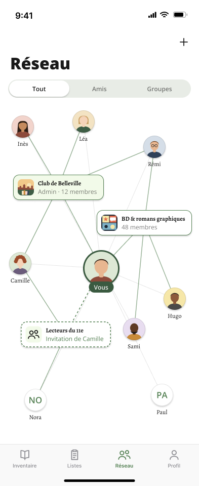

# R1 · Tout · Constellation

- **Figma node**: `512:15513`:
  https://www.figma.com/design/S7IvC6GvlcUFe5IgbtvQq6/Nouveau-r%C3%A9cits?node-id=512-15513
- **Section**: `Réseau · Graphe` (`512:15486`). The section's own spec panel is `Spec · Réseau en graphe`
  (`515:16039`): https://www.figma.com/design/S7IvC6GvlcUFe5IgbtvQq6/Nouveau-r%C3%A9cits?node-id=515-16039
- **Screenshot**: [`../screenshots/r1-tout-constellation.png`](../screenshots/r1-tout-constellation.png)
  (393 × 960, 1×)
- **Status in Figma**: a proposal and nothing more. The spec panel reads « Piste retenue : la constellation (ex-A),
  avec zoom. Proposition, rien d'implémenté. Mode clair seul. »

## What the screen is

The Réseau tab gets a third segment, **Tout**, on the left. It is selected here. Below the segmented control,
the whole network is drawn as a node-link graph, the "constellation": « Vous » in the middle, then my groups and
the group invitations I have received, then my friends. Edges show who belongs to what. This frame is the
**resting state**: nothing is touched, every node is at full strength, and the network is small enough (12 nodes)
to be drawn at full size without zooming.

## Frame and layer order

The screen frame is 393 × **960**, filled with `background/default` (#FFFFFF). The children are listed bottom to
top, so later children paint on top.

| # | Layer | Node | Kind | x, y | w × h |
|---|---|---|---|---|---|
| 1 | `graph` | `513:15806` | FRAME, **clips content**, no fill | 0, 195 | 393 × 682 |
| 2 | `status bar` | `512:15534` | INSTANCE `Chrome / Status Bar` · Theme=Light | 0, 0 | 393 × 59 |
| 3 | `nav` | `512:15535` | INSTANCE `Chrome / Nav Bar` (large title + trailing action glyph) | 0, 59 | 393 × 96 |
| 4 | `tab bar` | `512:15537` | INSTANCE `Chrome / Tab Bar · Réseau` · Active=Réseau | 0, 877 | 393 × 83 |
| 5 | `home indicator` | `512:15538` | INSTANCE `Chrome / Home Indicator` · Theme=Light | 0, 926 | 393 × 34 |
| 6 | `segmented control` | `519:16411` | INSTANCE `Chrome / Segmented Control · 3` · Selected=Left | 0, 155 | 393 × 40 |

The graph sits under all the chrome, and the segmented control is the topmost layer. The home indicator overlaps
the bottom 34 pt of the tab bar, as it does on a device.

> The frame is 960 pt tall, but no iPhone is: an iPhone 17 is 874 pt and the R5 sibling uses 852 pt. The graph area
> (682 pt here) is therefore a mock-up height. On a device it is whatever is left between the segmented control
> and the tab bar, so the layout has to be computed rather than fixed. See "Not drawn / ambiguous".

## Chrome

### Status bar (`512:15534`)

This is `Chrome / Status Bar`, Theme=Light, 393 × 59. It is literal iOS chrome, not a theme surface: the time
« 9:41 » is set in Inter SemiBold 17, black, at (30, 20), and the cellular, wifi and battery glyphs are black. It
has no fill, so the screen's `background/default` shows through. It is not implemented in the app, because the
system draws it.

### Navigation bar (`512:15535`), large title « Réseau » with a « + »

- It is `Chrome / Nav Bar`, large style, **96 pt** tall, sitting under the 59 pt status bar.
- **Background `background/default` (#FFFFFF)**. The component's own description calls the bar's background
  "literal system chrome", but here it is overridden to white. That follows the spec: « Le graphe est sur
  background/default (blanc), barre de navigation comprise ; les listes gardent background/secondary sous leurs
  cartes blanches. »
- **Title « Réseau »** (`I512:15535;26:115`) is set at left 20, right 20, top 44 inside the bar (screen y = 103). It
  uses `Title/title200`: Open Sans ExtraBold 32, line-height 100 % ("normal"), letter-spacing 0, colour
  `foreground/default` #191919.
  → `DesignSystem.TextStyle.title200` and `DesignSystem.Color.foregroundDefault`. The app already sets these through
  `largeTitleTextAttributes`.
- **Action glyph « + »** (`I512:15535;26:116`) is an `Icon` instance, glyph `plus`, 24 × 24. It sits 18 from the
  right edge and 12 from the top of the bar, at screen (351, 71). Its colour is `foreground/default`, because the
  `Icon` vectors are bound to that token. In SwiftUI it is
  `ToolbarItem(placement: .primaryAction) { Button(…, systemImage: "plus") }`.
  What it does on **Tout** is undecided (see below).

### Segmented control (`519:16411`): « Tout » | « Amis » | « Groupes »

- It is `Chrome / Segmented Control · 3`, with props Left label « Tout », Middle label « Amis », Right label
  « Groupes », and Selected=Left. Its component description reads « Trois segments : Tout | Amis | Groupes de
  l'onglet Réseau (proposition Réseau · Graphe). »
- **Outer frame**: 393 × 40, horizontal padding `spacing/medium` 16 (`.medium`) and vertical padding `spacing/small`
  8 (`.small`). The track's content is taller than 24 pt, though, so in the render the track overflows the frame and
  is drawn at about **y 157 → 193 (≈ 36 pt)**, measured from the screenshot.
- **Track**: fill `background/disable` #E8ECE6 (`.backgroundDisable`), padding `spacing/xx-small` 2 (`.xxSmall`),
  corner radius `radius/full` 360 (`CornerRadius.full`), clips content. The three segments split it equally
  (`flex 1`).
- **Selected segment « Tout »**: fill `background/default` #FFFFFF, corner radius 360 (a literal, not bound),
  padding `spacing/small` 8, and the `Shadow/Light` effect (0, 2, blur 3, `shadow/light` = black 18 %), which is
  `.shadow(.light)`. The label uses `Action/action200`: Open Sans SemiBold 12, line-height 100 %, letter-spacing 0,
  colour `foreground/default`. → `.textStyle(.action200)`.
- **Unselected « Amis », « Groupes »**: no fill, padding 8, same text style in `foreground/secondary` (black 50 %).
  → `.foregroundSecondary`.
- **Today in code**, `NetworkView` uses a system `Picker(.segmented)` with **two** cases (`NetworkSegment.friends`,
  `.groups`). It is placed as the first *row of the List* so that the large title collapses with the scroll. The
  design adds `Tout` as the first and default case.

### Tab bar (`512:15537`) and home indicator (`512:15538`)

- It is `Chrome / Tab Bar · Réseau`, Active=Réseau, 393 × 83. This is literal iOS chrome:
  - Fill rgba(249, 249, 249, 0.94).
  - A 0.5 pt hairline at the top, rgba(0, 0, 0, 0.16).
  - An items row 49 pt tall at top 4.
  - Four equal tabs, each a 26 pt glyph over its label with a gap of 2.
- The tabs are « Inventaire » (`book`), « Listes » (`list.clipboard`), **« Réseau »** (`person.2`, active) and
  « Profil » (`person`).
- Inactive labels are Inter Medium 10 in #8E8E93. The active label is Inter SemiBold 10 in `foreground/tinted`
  #558154.
- This matches the 4-tab bar shipped in feature 0028; nothing new.
- The home indicator grabber is 140 × 5, black, radius 2.5, at top 21 of the 34 pt inset.

## The graph (`513:15806`)

The `graph` frame is 393 × 682 at screen y 195. It runs from the bottom of the segmented control to the top of the
tab bar and **clips its content**. It has no fill of its own, so the screen's `background/default` white shows
through. Inside it, the layers from bottom to top are `edges`, then `Graph / Me`, then the three groups, then the
eight friends. **Edges are always under nodes, and friends are drawn above groups.**

### Node placement

Coordinates are **graph-local**: the origin is the graph frame's top-left, which is screen (0, 195). "Anchor" is
the point the edges meet. It is the centre of the avatar for people and the centre of the card for groups. Every
edge runs anchor to anchor and is hidden under the opaque nodes it joins.

| Node | Layer / node id | Frame x, y | w × h | Anchor (graph) | Anchor (screen) | Offset from « Vous » |
|---|---|---|---|---|---|---|
| « Vous » | `Graph / Me` `513:15828` | 164, 299 | 72 × 84 | **200, 335** | 200, 530 | 0, 0 |
| Club de Belleville | `group/Club de Belleville` `513:15830` | 26, 150 | 179 × 50 | 115, 175 | 115, 370 | −85, −160 |
| BD & romans graphiques | `group/BD & romans graphiques` `513:15841` | 191, 220 | 188 × 50 | 285, 245 | 285, 440 | +85, −90 |
| Lecteurs du 11e | `group/Lecteurs du 11e` `513:15852` | 41, 440 | 178 × 51 | 130, 465 | 130, 660 | −70, +130 |
| Inès | `friend/Inès` `513:15863` | −5, 33 | 100 × 64 | 45, 55 | 45, 250 | −155, −280 |
| Léa | `friend/Léa` `513:15867` | 115, 23 | 100 × 64 | 165, 45 | 165, 240 | −35, −290 |
| Rémi | `friend/Rémi` `513:15871` | 255, 73 | 100 × 64 | 305, 95 | 305, 290 | +105, −240 |
| Camille | `friend/Camille` `513:15875` | −10, 303 | 100 × 64 | 40, 325 | 40, 520 | −160, −10 |
| Hugo | `friend/Hugo` `513:15879` | 295, 373 | 100 × 64 | 345, 395 | 345, 590 | +145, +60 |
| Sami | `friend/Sami` `513:15883` | 215, 433 | 100 × 64 | 265, 455 | 265, 650 | +65, +120 |
| Nora | `friend/Nora` `513:15887` | 20, 573 | 100 × 64 | 70, 595 | 70, 790 | −130, +260 |
| Paul | `friend/Paul` `513:15891` | 270, 563 | 100 × 64 | 320, 585 | 320, 780 | +120, +250 |

What the layout intends, read from those numbers:

- **« Vous » sits at roughly the centre of the graph area**: (200, 335) against a frame centre of (196.5, 341).
- **Groups are in an inner ring**, 124 to 181 pt from « Vous ».
- **Friends are in an outer ring**, 137 to 320 pt away. Each friend sits near the group or groups it belongs to:
  - Inès, Léa and Rémi are above Club de Belleville.
  - Rémi, Hugo and Sami are around BD.
  - Camille sits between Club and Lecteurs du 11e.
  - Nora is below Lecteurs du 11e.
  - Paul belongs to no group, and floats on his own at the bottom right.
- The positions are hand-placed in Figma. The spec asks for a force-directed layout with a fixed seed instead:
  « Placement : graphe à forces à graine fixe, pour qu'il ne bouge pas d'une ouverture à l'autre ; fonction pure,
  testable. »
- Nodes are allowed to overflow the clip slightly:
  - The 100 pt label columns of Inès (x −5) and Camille (x −10) start left of the frame.
  - Hugo's column ends at x 395, past the 393 pt edge.
  - In every case the avatar circles themselves stay inside.

### Edges (`513:15827`, 20 vectors)

The `edges` frame is at graph (40, 45), 305 × 550, and holds one straight line per relationship. **All 20 are drawn
in R1.** The values below come from the vector export and from `get_variable_defs` on individual edges. Stroke caps
are not exposed, so assume butt caps; they are hidden under the nodes anyway.

| Edge type | Edges (layer names) | Stroke token | Hex | Width | Layer opacity | Dash |
|---|---|---|---|---|---|---|
| **friend ↔ group** (membership) | `edge/ines–club`, `edge/lea–club`, `edge/remi–club`, `edge/camille–club`, `edge/remi–bd`, `edge/hugo–bd`, `edge/sami–bd`, `edge/camille–l11`, `edge/nora–l11` | `foreground/tinted` | #558154 | **1.5** | **60 %** | solid |
| **« Vous » ↔ group I belong to** (member or admin) | `edge/me–club`, `edge/me–bd` | `foreground/tinted` | #558154 | **1.5** | **60 %** | solid |
| **« Vous » ↔ group I'm invited to** | `edge/me–l11` | `foreground/tinted` | #558154 | **1.5** | **100 %** | **dash 4, gap 4** |
| **« Vous » ↔ friend** | `edge/me–ines`, `edge/me–lea`, `edge/me–remi`, `edge/me–camille`, `edge/me–hugo`, `edge/me–sami`, `edge/me–nora`, `edge/me–paul` | `border/default` | #000000 @ 10 % | **1** | 100 % | solid |

Mapping to Swift:

- `foreground/tinted` is `DesignSystem.Color.foregroundTinted`, and `border/default` is `.borderDefault`. Both
  colours have tokens.
- **Nothing else does.** These values have no Swift token: the stroke widths 1, 1.5 and 2.5 (see R2), the 60 %
  edge opacity, and the `[4, 4]` dash. The only width token is `sizing/border/hairline` (1), which is
  `Constant.borderWidth` and marked dead code.
- The `Opacity` collection holds only `opacity/surface/plank` (92) and `opacity/surface/backdrop` (20).

Notes on the edges:

- **The edges to Lecteurs du 11e from friends (`camille–l11`, `nora–l11`) are solid 60 %**, like any membership.
  Only *my* edge to an invited group is dashed and full-strength.
- **The spec text and the drawing disagree.** The spec says « Arêtes : ami ↔ groupe (foreground/tinted, 60 %),
  vous ↔ groupe, vous ↔ ami (border/default). Invitation en pointillé. » That reads as if « Vous » ↔ group used
  `border/default`. The drawn and bound value for `edge/me–club` and `edge/me–bd` is `foreground/tinted` at 60 %,
  1.5 pt.
- **Edge endpoints**, in `edges`-frame coordinates: add (40, 45) to get graph-local coordinates.
  - « Vous » (160, 290), Club (75, 130), BD (245, 200), L11 (90, 420).
  - Inès (5, 10), Léa (125, 0), Rémi (265, 50), Camille (0, 280).
  - Hugo (305, 350), Sami (225, 410), Nora (30, 550), Paul (280, 540).

### Node components

There are three local components in the section, all in light mode only. The spec marks them « Composants
(locaux, à ne pas publier) ».

#### `Graph / Me` (`512:16006`), with no props

Instance `513:15828`, 72 × 84. It is a vertical stack, centred, and the label overlaps the avatar by **−10**
(`margin-bottom: -10` on the avatar).

- **Avatar** (`519:16387`):
  - 72 × 72 circle (radius 36), fill `background/default`, clips content.
  - **Border 3 pt `background/tinted-inverse` #3A5A40** (`.backgroundTintedInverse`).
  - Effect `Shadow/Light`, which is `.shadow(.light)`.
- **Photo slot** (`519:16278`): 72 × 72, offset (−3, −3) so that it fills the whole circle under the ring. It holds
  my inventaire.io user picture, which is dynamic data, not an asset. **There is no fallback layer**: unlike
  `Graph / Friend`, this component has no initials text under the photo.
- **Label** (`519:16388`):
  - A pill with fill `background/tinted-inverse` #3A5A40 and radius 360.
  - Padding **10 horizontal × 3 vertical**. Both are literals with **no Spacing token**: the scale goes
    2 / 4 / 8 / 12.
  - About 22 pt tall.
- **Text « Vous »** (`519:16389`): `Action/action200`, which is Open Sans SemiBold 12 (100 % line-height, 0
  tracking), in `foreground/inverse` #F1F1F1. → `.textStyle(.action200)` and `.foregroundInverse`.
- Values without a token: the 72 pt size, the 3 pt border, the −10 overlap, and the 10 / 3 padding.

#### `Graph / Friend` (`512:16016`)

The variants are `State=Default` (`512:16008`) and `State=Highlighted` (`512:16012`). The props are `Name` (text),
`Initials` (text) and `Show photo` (boolean). Every friend in R1 uses **State=Default**.

Each friend is a vertical stack **100 pt wide**, centred, with a **gap of 4** (a literal, equal in value to
`spacing/x-small` / `.xSmall`). It is 64 pt tall: 44 + 4 + 16.

- **Avatar** (`512:16009`):
  - 44 × 44 circle (radius 22, a literal), fill `background/default`, clips content.
  - Border **1 pt `border/default`** (black 10 %).
  - Effect `Shadow/Light`.
- **Initials** (`512:16010`) are always present, under the photo. They use `Action/action300`, which is Open Sans
  SemiBold 17, in `foreground/tinted` #558154. → `.textStyle(.action300)` and `.foregroundTinted`.
- **Photo slot** (`519:16259`): 44 × 44 at (−1, −1), covering the initials. It is shown when `Show photo` = true,
  and holds the friend's inventaire.io user picture.
- **Name** (`512:16011`): `Footnote/footnote200`, which is Alegreya Regular 12 (100 %, 0), in `foreground/default`.
  It is one line and centred. → `.textStyle(.footnote200)`.

The instances in R1:

| Instance | Name | Initials | Show photo |
|---|---|---|---|
| `friend/Inès` | « Inès » | « IN » | true |
| `friend/Léa` | « Léa » | « LÉ » | true |
| `friend/Rémi` | « Rémi » | « RÉ » | true |
| `friend/Camille` | « Camille » | « CA » | true |
| `friend/Hugo` | « Hugo » | « HU » | true |
| `friend/Sami` | « Sami » | « SA » | true |
| `friend/Nora` | « Nora » | « NO » | **false**: initials visible |
| `friend/Paul` | « Paul » | « PA » | **false**: initials visible |

The initials are **the first two letters of the name, upper-cased, accents kept** (« LÉ », « RÉ »). They are not
first and last initials, because inventaire.io usernames are a single word.

#### `Graph / Group` (`512:16061`)

The variants are `Role=Member, State=Default` (`512:16017`), `Role=Admin, State=Default` (`512:16028`),
`Role=Invited, State=Default` (`512:16039`) and `Role=Admin, State=Highlighted` (`512:16050`). The props are `Name`,
`Detail` and `Show picture`.

The base is a horizontal stack, items centred, made of a tile and a text column:

- **Gap** `spacing/small` 8. **Padding**: left `spacing/small` 8, right `spacing/s-medium` 12, top and bottom
  `spacing/small` 8. → `.small` and `.sMedium`.
- **Corner radius** `radius/rounded` 12. → `CornerRadius.rounded`.
- **Effect** `Shadow/Light`. The export shows it as a CSS `drop-shadow(0 2 1.5)`, which is the same Figma blur of 3.
  → `.shadow(.light)`.
- **Tile**:
  - 32 × 32, radius **8** (a literal, equal in value to `radius/medium` / `CornerRadius.medium`), clips content.
  - It holds an `Icon` glyph `person.2`, 24 × 24, in `foreground/default`. That glyph is the fallback.
  - On top of the glyph is a **picture slot** (`519:16274`), 32 × 32, object-fit cover, shown when
    `Show picture` = true. It holds the inventaire.io group picture.
- **Text column**, one line each, no wrapping, leading-aligned:
  - **Name** (`512:16026`): `Footnote/footnote200Bold`, which is Alegreya Bold 12, in `foreground/default`. →
    `.textStyle(.footnote200Bold)`.
  - **Detail** (`512:16027` / `512:16049`): `Caption/caption200`, which is Open Sans Regular 12, in
    `foreground/secondary`. For Invited it is in `foreground/tinted` instead. → `.textStyle(.caption200)`.

The variants differ as follows:

| Variant | Card fill | Card border | Tile fill | Detail colour |
|---|---|---|---|---|
| Member / Default | `background/default` #FFFFFF | **1 pt solid `border/tinted`** #558154 | `background/tinted` #F2FAE9 | `foreground/secondary` |
| Admin / Default | **`background/tinted`** #F2FAE9 | 1 pt solid `border/tinted` | **`background/default`** | `foreground/secondary` |
| Invited / Default | `background/default` | **1.5 pt dashed `foreground/tinted`**, dash ≈ **4 on / 3 off** | `background/tinted` | **`foreground/tinted`** |
| Admin / Highlighted (R2) | `background/tinted-inverse` #3A5A40 | 1 pt solid `background/tinted-inverse` | `background/default` | name and detail in `foreground/inverse` #F1F1F1 |

The dash of the invited card is not exposed by the API. It was **measured from the 1× render**: a period of 7 px,
made of 4 px of #558154 and 3 px blank, along the card's top edge. Treat `[4, 3]` as approximate, and do not
confuse it with the edge dash `[4, 4]`.

The instances in R1:

| Instance | Role | State | Name | Detail | Show picture |
|---|---|---|---|---|---|
| `group/Club de Belleville` | **Admin** | Default | « Club de Belleville » | « Admin · 12 membres » | true |
| `group/BD & romans graphiques` | Member | Default | « BD & romans graphiques » | « 48 membres » | true |
| `group/Lecteurs du 11e` | **Invited** | Default | « Lecteurs du 11e » | « Invitation de Camille » | **false**: `person.2` glyph on `background/tinted` |

Cards size to their content (hug): 179, 188 and 178 pt wide, 50 or 51 pt tall. The invited card's 1.5 pt stroke
makes it 1 pt bigger.

## Visual states shown in R1

- **Resting graph**: every node and edge is at full strength, nothing is selected, and no sheet is open.
- Three group roles are visible at once: **admin** (tinted card), **member** (white card) and **invited** (white
  card, dashed border, tinted detail, dashed edge to « Vous »).
- **Photo and fallback, both drawn**: friends with a photo (6), friends with initials (Nora, Paul), groups with a
  picture (2), and a group with the glyph (Lecteurs du 11e).
- **A friend in no shared group** (Paul): he is linked to « Vous » only. The spec lists this as an open question
  (see below).
- Segment **Tout** is selected.

## Interactions the design implies

These come from the frames and the spec panel. None of them has been prototyped in Figma: the file has no
prototype connections.

| Gesture | Result | Source |
|---|---|---|
| Tap « Amis » / « Groupes » | Switch to the R5 / R6 lists, which are the feature-0028 lists, « inchangées sauf photos ». | Spec, « Onglets » |
| **Pinch** | Zoom the graph. « Pincer et glisser, toujours. » | Spec, « Zoom » |
| **Drag** (one finger on empty space) | Pan the graph. | Spec, « Zoom » |
| Open the tab / segment | « Le graphe s'ouvre cadré sur tout le réseau. » The initial transform fits every node. | Spec, « Zoom » |
| **Tap a group node** | Go to R2: its edges light up, the rest drops to 30 %, and a summary sheet opens. | Spec, « Toucher un nœud (R2) » |
| **Tap a friend node** | « Même geste pour un ami (« Voir le profil ») »: same highlight, and a sheet whose button reads « Voir le profil ». | Spec |
| Tap empty space while a node is selected | « Toucher le vide referme. » | Spec |
| Tap « + » | **Undecided**: « Le « + » de la barre sur l'onglet Tout : ajouter un ami, créer un groupe, ou un menu des deux. » | Spec, « À trancher » 4 |
| Zoom controls (+, −, recentre on « Vous ») | Present in R3/R4 only, as « pour qui ne pince pas ». **Not drawn in R1.** | Spec, R3/R4 |

## What changes vs the sibling screens

- **R2 · Tout · Groupe touché** (`512:15657`) has the same layout and the same coordinates, with Club de Belleville
  touched:
  - The touched group switches to `Role=Admin, State=Highlighted`.
  - Its four friends switch to `State=Highlighted`.
  - Its five edges go to 2.5 pt and 100 %.
  - Every other edge drops to 12 %.
  - The other nodes drop to 30 %.
  - A bottom card « sheet · groupe » appears.
- **R3 · Tout · Vue d'ensemble · Dézoomé** (`520:15762`) is the semantic zoom-out for a large network (42 friends,
  7 groups):
  - Friends become 24 pt dots with no name (`Graph / Friend · Dot`).
  - Groups become 52 pt compact tiles with their name (`Graph / Group · Compact`).
  - The « Vous » ↔ friend edges disappear, and « Vous » drops to 70 %.
  - It adds `Graph / Zoom Controls` (bottom right, 331, 725, 46 × 136) and the counter « 42 amis · 7 groupes »
    (bottom left, 16, 831).
- **R4 · Tout · Zoomé** (`522:15982`) is zoomed in:
  - Nodes are full size with names.
  - Edges leave the screen towards off-screen nodes.
  - It has the same zoom controls and counter.
  - It adds a **minicarte** (281, 207, 96 × 140) at the top right with a viewport rectangle.
- **R5 · Amis** and **R6 · Groupes** are lists on `background/secondary`, not the graph. R1's white background,
  nav bar included, is specific to the Tout segment.
- **R1 has neither zoom controls nor a counter.** The spec says the overview kicks in « au-delà de 20 nœuds », and R1
  has 12, so R1 is presumably what a small network looks like at its fitted scale. Whether the controls and counter
  also show for a small network is not said.

## Data behind the drawing (from the spec)

« Rien de neuf côté serveur : GET /api/groups (rôles), relations pour les amis, picture des users et des groupes
déjà dans les DTO. Arêtes calculées localement. »

- **Groups and roles** come from `GET /api/groups`. The role maps to the Admin, Member or Invited variant.
- **Friends** come from relations.
- **Membership edges** are computed locally: a friend ↔ group edge exists when that friend is a member of a group
  that is in my graph.
- **Pictures**: the user `picture` and the group `picture` are already in the DTOs. Every avatar and group image in
  the file is a mock-up illustration (`assets · avatars` `519:16039`, `assets · images de groupe` `519:16210`) and is
  **not** to be shipped.

## Not drawn / ambiguous

1. **Device height.** The frame is 393 × 960, which is not a device size. The graph area must be computed from the
   real space between the segmented control and the tab bar. Should it also extend under a translucent tab bar?
2. **Large title behaviour.** Today the segmented control is a List row, so the large title collapses on scroll.
   The graph does not scroll, it pans and zooms. Does « Réseau » stay large and the control stay pinned, or does
   panning collapse the title? Not drawn.
3. **The « + » on Tout**: add a friend, create a group, or a menu of both. This is spec « À trancher » 4.
4. **Spec vs drawing, « Vous » ↔ group edge.** The spec text suggests `border/default`, but the drawing binds
   `foreground/tinted` at 60 %, 1.5 pt. Which one wins?
5. **Opacity and stroke values without tokens.** The 60 % / 100 % edges, the 1 / 1.5 pt widths, the `[4, 4]` edge
   dash, the ≈ `[4, 3]` card dash, the Me ring of 3 pt and pill of 10 × 3, and the friend column of 100 pt. Add
   tokens, or keep them as feature-local constants?
6. **Card dash pattern** is measured, not read. Confirm `[4, 3]` in Figma.
7. **No fallback for « Vous »** when I have no picture. `Graph / Me` has no initials layer.
8. **Friends in no shared group** (Paul here, and Sarah, Nathan, Mila and Clara in R3): « Montrer les amis sans
   groupe commun ». This is spec « À trancher » 2.
9. **Sent requests** (« Demandes envoyées dans le graphe ou non ») are not drawn. This is spec « À trancher » 3.
   Neither are pending friend invitations received, which R5 shows as a list section.
10. **Semantic zoom threshold**: « 20 nœuds ? ». This is spec « À trancher » 1.
11. **Dark mode, empty state (no friends, no groups), loading / first sync (feature 0027 shows progress), and
    VoiceOver** are not drawn. This is spec « À trancher » 5. The spec suggests VoiceOver read « Tout » as the list
    of groups, each followed by its friends.
12. **Edge order and overlap.** The order is fixed: `me–*` first, friend–group last. Label collisions are not
    addressed: a long name, a node close to another, or a card over an edge. In R1 several lines pass under a
    card that is not their endpoint, which hides them: `me–remi` passes under the BD card, and `me–ines` and
    `me–lea` pass under the Club de Belleville card.
13. **Tapping « Vous »**, or an invited group, is not specified. The invited group probably needs accept / decline;
    see R2.
14. **Clipping.** Label columns overflow the graph frame (Inès, Camille, Hugo). Should the real graph keep a
    margin, or let the edges of the fitted view clip?
15. **Typography of the chrome.** The status bar and tab bar use Inter as a stand-in for the system font. They are
    not app tokens and need no implementation.
