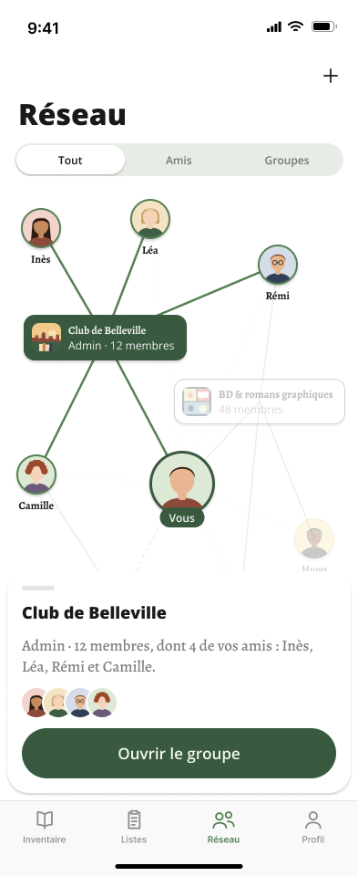

# R2 · Tout · Groupe touché

- **Figma node**: `512:15657`:
  https://www.figma.com/design/S7IvC6GvlcUFe5IgbtvQq6/Nouveau-r%C3%A9cits?node-id=512-15657
- **Sheet node**: `sheet · groupe` `514:16113`:
  https://www.figma.com/design/S7IvC6GvlcUFe5IgbtvQq6/Nouveau-r%C3%A9cits?node-id=514-16113
- **Section**: `Réseau · Graphe` (`512:15486`). Spec panel `Spec · Réseau en graphe` (`515:16039`).
- **Screenshot**: [`../screenshots/r2-tout-groupe-touche.png`](../screenshots/r2-tout-groupe-touche.png)
  (393 × 960, 1×)
- **Read first**: [`r1-tout-constellation.md`](r1-tout-constellation.md). R2 is R1 with one node touched. The chrome,
  the coordinates, the component anatomy and the token mapping are identical, and are not repeated here.

## What the screen is

The user has **tapped the group « Club de Belleville »** in the Tout graph. In the spec's words, « Ses arêtes
s'allument, le reste passe à 30 %, une feuille résume — nom, rôle, membres, avatars des amis en commun — et ouvre la
fiche. Toucher le vide referme. Même geste pour un ami (« Voir le profil ») ». Three things happen:

1. The group, its member-friends and the edges joining them are **highlighted**.
2. Everything else is **dimmed**.
3. A **summary card** rises from the bottom, above the tab bar.

## Frame and layer order

The frame is 393 × 960 with fill `background/default`. Children are listed bottom to top:

| # | Layer | Node | Kind | x, y | w × h |
|---|---|---|---|---|---|
| 1 | `graph` | `514:16002` | FRAME, clips content | 0, 195 | 393 × 682 |
| 2 | `status bar` | `512:15678` | `Chrome / Status Bar` · Theme=Light | 0, 0 | 393 × 59 |
| 3 | `nav` | `512:15679` | `Chrome / Nav Bar`, « Réseau » + « + », fill `background/default` | 0, 59 | 393 × 96 |
| 4 | `tab bar` | `512:15681` | `Chrome / Tab Bar · Réseau` · Active=Réseau | 0, 877 | 393 × 83 |
| 5 | `home indicator` | `512:15682` | `Chrome / Home Indicator` · Theme=Light | 0, 926 | 393 × 34 |
| 6 | `segmented control` | `519:16419` | `Chrome / Segmented Control · 3` · Selected=Left (« Tout ») | 0, 155 | 393 × 40 |
| 7 | **`sheet · groupe`** | `514:16113` | FRAME, auto-layout vertical | **8, 626** | **377 × 243** |

The chrome is unchanged from R1: the nav still shows the « + » and the segment is still « Tout ». **No scrim**
covers the graph or the chrome. The only overlay is the card, which is the topmost layer.

## Graph: what is highlighted, what is dimmed

The node positions are those of R1, node for node. Only variants and opacities change.

### Nodes

| Node | Instance (R2 id) | R1 | **R2** |
|---|---|---|---|
| Club de Belleville (the touched group) | `514:16025` | Graph / Group · Role=Admin, State=Default | **Role=Admin, State=Highlighted**, 100 % |
| Inès | `514:16028` | Graph / Friend · State=Default | **State=Highlighted**, 100 % |
| Léa | `514:16029` | State=Default | **State=Highlighted**, 100 % |
| Rémi | `514:16030` | State=Default | **State=Highlighted**, 100 % |
| Camille | `514:16031` | State=Default | **State=Highlighted**, 100 % |
| « Vous » | `514:16024` | Graph / Me | **unchanged**: not dimmed, not highlighted, 100 % |
| BD & romans graphiques | `514:16026` | Member / Default | Member / Default, **layer opacity 30 %** |
| Lecteurs du 11e | `514:16027` | Invited / Default | Invited / Default, **layer opacity 30 %** |
| Hugo | `514:16032` | Default | Default, **30 %** |
| Sami | `514:16033` | Default | Default, **30 %** |
| Nora | `514:16034` | Default (no photo) | Default, **30 %** |
| Paul | `514:16035` | Default (no photo) | Default, **30 %** |

The rule is that **the touched group and the friends who are members of it are highlighted, « Vous » stays as it
was, and every other node goes to 30 %**. The group's member-friends are exactly the four people the sheet names.
Rémi also belongs to BD and Camille is also linked to Lecteurs du 11e. They are highlighted all the same: the
highlight is about *this* group, not exclusive membership.

#### The highlighted variants

**`Graph / Group` · Role=Admin, State=Highlighted** (`512:16050`) inverts the admin card:

- **Card fill `background/tinted-inverse` #3A5A40** (`.backgroundTintedInverse`).
- **Border 1 pt solid `background/tinted-inverse`**, so it does not read as a separate stroke.
- **Tile fill `background/default`** #FFFFFF, which here is covered by the group picture.
- **Name** « Club de Belleville »: `Footnote/footnote200Bold` (Alegreya Bold 12) in **`foreground/inverse`**
  #F1F1F1.
- **Detail** « Admin · 12 membres »: `Caption/caption200` (Open Sans Regular 12) in **`foreground/inverse`**
  #F1F1F1. → `.foregroundInverse`.
- The padding, gap, radius 12 and `Shadow/Light` are unchanged. The size is unchanged: 179 × 50 at graph (26, 150).

**`Graph / Friend` · State=Highlighted** (`512:16012`):

- **Avatar fill `background/tinted`** #F2FAE9 (`.backgroundTinted`). It shows only when there is no photo.
- **Border 2 pt `foreground/tinted`** #558154. The token is `foreground/tinted`, not `border/tinted`; the value is
  the same, and Swift uses the same `case` for both. The photo slot (`519:16260`) moves to (−2, −2) to sit under the
  thicker ring.
- **Name in `Footnote/footnote200Bold`** (Alegreya **Bold** 12), `foreground/default`. → `.textStyle(.footnote200Bold)`.
- The size (44 pt avatar, 100 × 64 column, gap 4) and `Shadow/Light` are unchanged.

**Variants that do not exist.** `Graph / Group` has **no** `Member / Highlighted` and **no**
`Invited / Highlighted`. Tapping « BD & romans graphiques » or « Lecteurs du 11e » cannot be drawn with the current
component set. See the open points below.

### Edges

The `edges` frame is `514:16003`: 20 vectors, with the same endpoints as in R1.

| Edge group | Edges | Stroke | Width | Layer opacity | Dash |
|---|---|---|---|---|---|
| **Highlighted**: every edge incident to the touched group | `edge/me–club`, `edge/ines–club`, `edge/lea–club`, `edge/remi–club`, `edge/camille–club` | `foreground/tinted` #558154 | **2.5** | **100 %** | solid |
| Dimmed friend ↔ group | `edge/remi–bd`, `edge/hugo–bd`, `edge/sami–bd`, `edge/camille–l11`, `edge/nora–l11` | `foreground/tinted` | 1.5 (as R1) | **12 %**, replacing R1's 60 % | solid |
| Dimmed « Vous » ↔ group | `edge/me–bd` | `foreground/tinted` | 1.5 | **12 %**, replacing 60 % | solid |
| Dimmed « Vous » ↔ invited group | `edge/me–l11` | `foreground/tinted` | 1.5 | **12 %**, replacing 100 % | dash 4, gap 4 |
| Dimmed « Vous » ↔ friend | `edge/me–ines`, `edge/me–lea`, `edge/me–remi`, `edge/me–camille`, `edge/me–hugo`, `edge/me–sami`, `edge/me–nora`, `edge/me–paul` | `border/default` (black 10 %) | 1 | **12 %** | solid |

Notes on the edges:

- **Edges dim to 12 %, not 30 %.** Nodes go to 30 % but edges go to **12 %**. The values were read from the
  vector export: `opacity="0.12"` on the 15 dimmed paths, and no group opacity. The spec text says « le reste passe à
  30 % ». The difference is probably deliberate: a 30 % line under a 30 % node would still read as a path. But it
  is not written down.
- **The 12 % replaces the R1 layer opacity. It does not multiply it.** A dimmed membership edge is #558154 at 12 %.
  A dimmed « Vous » ↔ friend edge is black 10 % stroke × 12 % layer, about **1.2 % effective alpha**, which is
  invisible in practice. It is visible in the screenshot only as a faint trace.
- **The « Vous » ↔ friend edges of the highlighted friends** (`me–ines`, `me–lea`, `me–remi`, `me–camille`) are
  **dimmed too**. Only the touched node's own edges light up: group ↔ member and group ↔ « Vous ».
- The highlight stroke of **2.5 pt** has no Swift token, and neither do the 12 % or 30 %. The `Opacity` collection
  holds only 92 and 20.

## The summary card: `sheet · groupe` (`514:16113`)

### Box

| Property | Value | Swift |
|---|---|---|
| Position | screen x **8**, y **626** (absolute, not auto-laid-out against the screen) | none: 8 equals `Spacing.small` in value |
| Size | **377 × 243**. The width is 393 − 2 × 8. The height hugs the content. | none |
| Bottom edge | y 869, which is **8 pt above the tab bar** (877) | none |
| Fill | `background/default` #FFFFFF | `.backgroundDefault` |
| Corner radius | **24**, on all four corners. A **literal**, not bound. | value of `CornerRadius.roundedLarge` |
| Effect | `Shadow/Light`: (0, 2), blur 3, `shadow/light` black 18 % | `.shadow(.light)` |
| Border | none | none |
| Clip content | yes | none |
| Layout | vertical auto-layout, items **leading**, **padding 16** on all sides, **gap 12**. Both are literals, not bound. | values of `Spacing.medium` / `Spacing.sMedium` |

Content width is 377 − 2 × 16 = **345**.

### Contents, top to bottom

The positions are relative to the card. Each item's y follows from padding 16 and a gap of 12:
16 → 33 → 70 → 128 → 172.

1. **Grabber** (`514:16114`, a rectangle named `Rectangle`):
   - 36 × 5, radius **3** (a literal, with no CornerRadius token), fill `border/default` (black 10 %), at (16, 16).
   - **It is leading-aligned, not centred**, because the stack aligns its items to the start. The system grabber is
     centred. This is probably an auto-layout artefact (see the open points).
2. **Title** (`514:16115`): « Club de Belleville »
   - `Title/title50`: Open Sans ExtraBold **18**, line-height 100 %, letter-spacing 0, in `foreground/default`
     #191919. → `.textStyle(.title50)` and `.foregroundDefault`.
   - It spans the full width (345) and is 25 tall, at (16, 33).
3. **Body** (`514:16116`): « Admin · 12 membres, dont 4 de vos amis : Inès, Léa, Rémi et Camille. »
   - `Content/content300`: Alegreya **Medium 17**, line-height 100 %, letter-spacing 0, in
     **`foreground/secondary`** (black 50 %). → `.textStyle(.content300)` and `.foregroundSecondary`.
   - It spans the full width and wraps to **2 lines**: 345 × 46 at (16, 70).
   - The visible line break falls after « Inès, ».
4. **Friends in common** (`522:16837`, frame `amis en commun`):
   - A horizontal stack, items top-aligned, clips content, **104 × 32** at (16, 128).
   - It holds four ellipses: `avatar/Inès` (`522:16838`), `avatar/Léa` (`522:16839`), `avatar/Rémi` (`522:16840`)
     and `avatar/Camille` (`522:16841`).
   - **Size**: each avatar is a **32 × 32 circle** with an image fill. The slot is the friend's inventaire.io picture.
   - **Overlap**: each of the first three has a margin of **−8** after it, so the step is 24 pt and the overlap is
     8 pt. The total is 32 + 3 × 24 = 104.
   - **Border**: each ellipse has a **2 pt stroke in `background/default`** (#FFFFFF, read with `get_variable_defs`),
     drawn **outside**. The exported bitmap is 36 × 36 for a 32 pt ellipse, which is 2 pt on each side. The white
     ring separates the overlapping circles.
   - **Stacking**: **each avatar is drawn over the one before it**, so Camille is on top and Inès at the bottom.
     This was checked on an upscaled crop of the screenshot.
   - **Order** is the same as the names in the body copy.
   - **Fallback**: none is drawn. These are bare ellipses, not `Graph / Friend` instances, so there is no initials
     layer for a friend without a photo.
5. **Button** (`514:16117`): an instance of `Button / Large`, Style=Primary, State=Default, Label « Ouvrir le
   groupe ».
   - It is **full width** (345 × 55) at (16, 172).
   - Fill `background/tinted-inverse` #3A5A40. Label `Action/action300` (Open Sans SemiBold 17) in
     `foreground/tinted-inverse` #F2FAE9, centred.
   - Padding `spacing/medium` 16 vertical × `spacing/large` 24 horizontal, radius `radius/full` 360.
   - → `LargeButtonStyle`, `.buttonStyle(.primary())`, made full-width. Pressed is a transform (`scaleEffect(0.9)`),
     not a variant.

### Copy pattern implied by the body text

The body reads « Admin · 12 membres, dont 4 de vos amis : Inès, Léa, Rémi et Camille. » Its parts are:

- `Admin` is my role. It probably only appears when I am admin: compare the member card detail « 48 membres ».
- `· 12 membres` is the group's member count, the same as the card's detail.
- `, dont 4 de vos amis : ` is the number of my friends who are members.
- `Inès, Léa, Rémi et Camille` is their names: comma-separated, with « et » before the last.
- The sentence ends with `.`.

None of these is drawn: one friend in common (the singular « dont 1 de vos amis » / « une de vos amies »?), zero
friends in common, the member variant, the invited variant, and many friends (do all the names and avatars show,
or is the list truncated?).

## Visual states shown in R2

- **Selection of a group**, here my **admin** group. The highlight uses the inverted admin card.
- **Highlighted friends**: 4, all with photos.
- **Dimmed nodes**: two groups (member, invited) and four friends, two of them with initials.
- **A sheet open over a live graph**: no scrim, and the graph is still visible above the card. Behind the card are
  Lecteurs du 11e, Sami, Nora and Paul. Hugo's avatar stays above the card, but his faded name « Hugo » is cut by
  the card's top edge.

## Interactions the design implies

| Gesture | Result | Source |
|---|---|---|
| Tap a group node (from R1) | Arrive at R2: highlight, dim, card. | Spec, « Toucher un nœud (R2) » |
| Tap **« Ouvrir le groupe »** | « … et ouvre la fiche »: push the group detail. Today that is `NavigationDestination.group(id:)` → `GroupDetailView`. | Spec + existing code |
| **Tap empty space** in the graph | « Toucher le vide referme »: close the card and return to R1. | Spec |
| Tap another node while the card is open | Not stated. The natural reading is that selection moves to that node. | Inferred |
| Tap a friend node | Same gesture. The card's button reads **« Voir le profil »** and pushes the friend's profile (`UserDetailView`). **Not drawn.** | Spec |
| Drag the grabber | Not stated. The grabber suggests a sheet that can be dragged down to dismiss, and perhaps up to expand. | Inferred from the grabber |
| Pinch / pan while the card is open | Not stated. Presumably still allowed: « Pincer et glisser, toujours ». | Spec, « Zoom » |
| Tap an avatar in « amis en commun » | Not stated. | none |

## What changes vs the sibling screens

- **vs R1**:
  - Club de Belleville becomes Admin / **Highlighted**.
  - Inès, Léa, Rémi and Camille become **Highlighted**.
  - The 5 incident edges go to **2.5 pt / 100 %**, and the 15 other edges to **12 %**.
  - 6 nodes go to **30 %**, while « Vous » stays.
  - The **sheet · groupe** card appears.
  - The chrome, segment, positions and nav « + » are unchanged.
- **vs R3 / R4** (the zoomed states): R2 is drawn at R1's scale. Selecting a node while zoomed out (R3, with
  compact tiles and dots) or zoomed in (R4, with the minimap) is not drawn. Neither is the zoom controls' position
  relative to the card: in R3/R4 they sit at y 725–861, which the card (y 626–869) would cover.
- **vs R6 · Groupes**: the list row for the same group pushes the group detail directly. In the graph, a tap first
  previews in the card.

## Not drawn / ambiguous

1. **Sheet or overlay?** The card floats 8 pt from the screen edges and **8 pt above a still-visible tab bar**,
   with 24 pt corners all round and no scrim.
   - A SwiftUI `.sheet` with a height detent covers the tab bar. It leaves the graph undimmed and interactive only
     with `.presentationBackgroundInteraction(.enabled)`.
   - A custom overlay inside the tab's content keeps the tab bar.
   - Which one is meant? The answer decides how « toucher le vide referme » and graph gestures behind the card work.
2. **Grabber alignment.** It is leading-aligned at x 16. Is that intentional or an auto-layout slip? The system
   grabber is centred.
3. **Edge dim 12 % vs spec 30 %.** Confirm that edges and nodes dim differently.
4. **Highlight scope.** Only the touched group's edges light up. The highlighted friends' « Vous » ↔ friend edges
   stay dimmed. Confirm that this is wanted.
5. **Missing variants.** There is no `Graph / Group` Member / Highlighted or Invited / Highlighted, and no friend
   card. What do a **member** group, an **invited** group, and a **friend** look like when touched? The friend case
   is described in the spec with the button « Voir le profil ». For an **invited** group, does the card offer
   accept / decline, as the R6 invitation row does?
6. **Card content variants** that are not drawn:
   - a member (non-admin) group;
   - zero, one, or many friends in common (do the avatars and names truncate?);
   - a friend without a photo in « amis en commun » (there is no fallback layer);
   - a long group name (title wrap?);
   - French plural and gender agreement in « dont N de vos amis ».
7. **Typography of « : »**. French wants a narrow no-break space before the colon. The API output does not show
   whether the file uses one; check before writing the localisation string.
8. **Overlap of the card with the graph.** The card hides the bottom 250 pt of the graph, including dimmed nodes.
   Should the graph re-centre or pan so that the selected node and its neighbours stay above the card?
9. **Tokens.** These values have no token, or are unbound literals:
   - the 2.5 pt highlight stroke, the 2 pt highlighted ring, and the 2 pt avatar ring in the sheet;
   - the 12 % and 30 % dims;
   - the 36 × 5 grabber with radius 3;
   - the 24 radius, 16 padding, 12 gap and 8 inset, which are unbound literals equal to existing Swift tokens.
10. **Animation.** The transitions are not specified: the highlight in and out, the card appearing, and the dimming
    duration and curve. The file has no motion.
11. **Dark mode, VoiceOver**, and how the selected state is announced: not drawn (spec « À trancher » 5).
