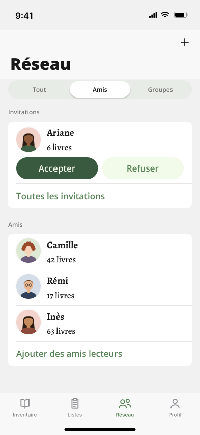

# R5 · Amis — the Réseau tab, « Amis » segment

- **Figma node:** `522:16586` "R5 · Amis" —
  https://www.figma.com/design/S7IvC6GvlcUFe5IgbtvQq6/Nouveau-r%C3%A9cits?node-id=522-16586
- **Section:** "Réseau · Graphe" (`512:15486`), file `S7IvC6GvlcUFe5IgbtvQq6`, page `Screens`. Light mode only.
- **Screenshot:** [`../screenshots/r5-amis.png`](../screenshots/r5-amis.png) (393 × 852, 1×)
- **Status:** proposal. The section's spec panel (`515:16039`, "Spec · Réseau en graphe") says the Amis (R5) and
  Groupes (R6) segments are **the lists of feature 0028, unchanged except for the photos**. The graph lives only
  under the new « Tout » segment (R1–R4).
- **Direct ancestor:** `A1 · Réseau · Amis` (`500:14173`, section "Réseau · Onglet & Groupes" `499:14069`). R5 is a
  layer-for-layer copy of A1. The only visible changes are listed under
  [What changes vs sibling screens](#what-changes-vs-sibling-screens).



---

## 1. Frame and chrome layout

Frame: 393 × 852 (iPhone 6.1"). Fill `background/secondary` `#F1F1F1` (→ `DesignSystem.Color.backgroundSecondary`,
applied in code by `applyListBackground()`).

The `scroll` frame is the **bottom** layer. All chrome instances sit above it, so content is meant to scroll
underneath the nav bar, the segmented control band and the tab bar.

| Band | Node | x, y | w × h | Notes |
|---|---|---|---|---|
| Status bar | `522:16604` | 0, 0 | 393 × 59 | `Chrome / Status Bar` (`24:30`), Theme=Light. No fill |
| Nav bar (large title) | `522:16605` | 0, 59 | 393 × 96 | `Chrome / Nav Bar` (`26:162`), Large style with the action glyph shown |
| — title « Réseau » | `I522:16605;26:115` | 20, 103 (abs) | 353 wide (left 20 / right 20) | `Title/title200` |
| — « + » action glyph | `I522:16605;26:116` | 351, 71 (abs) | 24 × 24 | right inset 18, top 12 inside the bar |
| Segmented control | `522:16663` | 0, 155 | 393 × 40 | `Chrome / Segmented Control · 3` (`518:510`), Selected=Middle. **No fill**: sits on the screen grey |
| — visible track | — | 16, ≈157 | 361 × ≈36 | 36 = 2 + 32 + 2; it overflows the 24 pt content box of the 40 pt band and is centred on y = 175 |
| Scroll content | `522:16587` | 0, 211 | 393 × 505 | starts 16 pt under the segmented band (195 → 211) |
| Tab bar | `522:16607` | 0, 769 | 393 × 83 | `Chrome / Tab Bar · Réseau` (`498:14327`), Active=Réseau |
| Home indicator | `522:16608` | 0, 818 | 393 × 34 | `Chrome / Home Indicator` (`24:35`), Theme=Light. Overlaps the tab bar's bottom 34 pt |

### Chrome details

**Status bar** (iOS stand-in, literal colours, no tokens): « 9:41 » Inter Semi Bold 17, black, at x 30 / y 20.
Cellular 18 × 12 (right 82, top 23), four black bars 3 wide, heights 4 / 6.5 / 9 / 11.5, radius 1, x 0 / 4.2 / 8.4 /
12.6. Wi-Fi 17 × 12 (right 60, top 23). Battery shell 25 × 12, 1 pt border `rgba(0,0,0,0.4)`, radius 3.5 (right 26,
top 23). Cap 1.5 × 4.5, `rgba(0,0,0,0.4)`, radius 1 (right 23, top 26.7). Level 18 × 8, black, radius 2 (right 31,
top 25).

**Nav bar:** fill `rgba(249,249,249,0.94)`. This is a literal iOS chrome value with no token. In code, UIKit draws the
bar. Title « Réseau »: `Title/title200` = Open Sans ExtraBold 32, line height auto, letter spacing 0,
`foreground/default` `#191919`. Swift: `TextStyle.title200`, which `DesignSystem.getDefaultAppearance()` sets as
`largeTitleTextAttributes`. Action: an `Icon` instance showing `plus`, 24 × 24, vectors bound to `foreground/default`.
No back chevron, because this is a tab root.

**Segmented control** (`Chrome / Segmented Control · 3`, component description: « Trois segments : Tout | Amis | Groupes
de l'onglet Réseau »):

| Part | Value | Token → Swift |
|---|---|---|
| Band | 393 × 40, padding H 16 / V 8 | `spacing/medium` → `.medium`, `spacing/small` → `.small` |
| Track | FILL width (361), fill `#E8ECE6`, radius 360, padding 2, clips content | `background/disable` → `.backgroundDisable`; `radius/full` → `.full`; `spacing/xx-small` → `.xxSmall` |
| Segment (×3) | equal widths (≈ 119 each), padding 8 on all sides | `spacing/small` → `.small` |
| Label | Open Sans SemiBold 12, line height auto, letter spacing 0 | `Action/action200` → `TextStyle.action200` |
| Unselected label | `#00000080` | `foreground/secondary` → `.foregroundSecondary` |
| Selected segment (« Amis ») | fill `#FFFFFF`, radius 360 (raw value, not bound), drop shadow x 0 / y 2 / blur 3 / spread 0 in `#0000002E` | `background/default` → `.backgroundDefault`; `Shadow/Light` → `DesignSystem.Shadow.light` |
| Selected label | `#191919` | `foreground/default` → `.foregroundDefault` |
| Labels | « Tout » · « Amis » · « Groupes » | « Tout » has **no string key** today |

No Swift component draws a custom segmented control like this one. The closest pieces are `PillButtonStyle` and
`TagLabelStyle`. Today the code uses the system `Picker(.segmented)`.

**Tab bar** (iOS stand-in): fill `rgba(249,249,249,0.94)`. Top hairline 0.5 pt `rgba(0,0,0,0.16)`. Item row 49 tall,
4 pt from the top. Four equal tabs, each a vertical stack: 26 × 26 glyph, 2 pt gap, label. Tabs are « Inventaire »,
« Listes », « Réseau » (active) and « Profil ». Inactive labels: Inter Medium 10, `#8E8E93`. Active label: Inter Semi
Bold 10, `foreground/tinted` `#558154`. All of these are literals except the active tint, and in code the system
`TabView` draws the whole bar. **No badge is drawn on « Réseau »**, even though an invitation is waiting on screen.

**Home indicator:** grabber 140 × 5, black, radius 2.5, horizontally centred, 21 pt from the top of the 34 pt band.

---

## 2. Layer hierarchy (exact copy)

```
R5 · Amis                                   FRAME 522:16586   393×852   fill background/secondary
├─ scroll                                   FRAME 522:16587   x0 y211 393×505  VERTICAL, gap spacing/large (24), items centred, clip
│  ├─ section/Invitations                   FRAME 522:16588   y0   393×196  VERTICAL, gap spacing/x-small (4), items centred, clip
│  │  ├─ header                             INSTANCE 522:16589  Section Header (28:164)  Label="Invitations"  Show action=false   393×24
│  │  └─ list group                         FRAME 522:16590   x16 y28 361×168  fill background/default, radius/medium (8), clip, VERTICAL gap 0
│  │     ├─ invitation/Ariane               INSTANCE 522:16591  Cell / Invitation (405:374)  361×120
│  │     │  ├─ user                         HStack, gap 12, items CENTER, clip
│  │     │  │  ├─ avatar                    48×48, radius/full, Shadow/Thumbnail, image fill (mock illustration)
│  │     │  │  └─ texts                     VStack, gap spacing/x-small (4), FILL, foreground/default
│  │     │  │     ├─ "Ariane"               Content/content400Bold
│  │     │  │     └─ "6 livres"             Content/content300
│  │     │  └─ actions                      HStack, gap 8, clip
│  │     │     ├─ Action / Pill (358:357)   Style=Prominent, glyph hidden, FILL — "Accepter"
│  │     │     └─ Action / Pill (358:357)   Style=Tinted,    glyph hidden, FILL — "Refuser"
│  │     ├─ separator                       INSTANCE 522:16592  Separator (47:193)  361×1
│  │     └─ see all                         INSTANCE 522:16593  Row / Link (38:200)  Tone=Tinted  Label="Toutes les invitations"  361×47
│  └─ section/Amis                          FRAME 522:16594   y220 393×285  VERTICAL, gap spacing/x-small (4)
│     ├─ header                             INSTANCE 522:16595  Section Header (28:164)  Label="Amis"  Show action=false   393×24
│     └─ list group                         FRAME 522:16596   x16 y28 361×257  fill background/default, radius/medium (8), clip
│        ├─ friend/Camille                  INSTANCE 522:16597  Cell / User (30:179)  Username="Camille"  Item count="42 livres"   361×69
│        ├─ separator                       INSTANCE 522:16598  Separator (47:193)
│        ├─ friend/Rémi                     INSTANCE 522:16599  Cell / User  Username="Rémi"  Item count="17 livres"   361×69
│        ├─ separator                       INSTANCE 522:16600  Separator
│        ├─ friend/Inès                     INSTANCE 522:16601  Cell / User  Username="Inès"  Item count="63 livres"   361×69
│        ├─ separator                       INSTANCE 522:16602  Separator
│        └─ add friends                     INSTANCE 522:16603  Row / Link  Tone=Tinted  Label="Ajouter des amis lecteurs"  361×47
├─ status bar                               INSTANCE 522:16604  Chrome / Status Bar (24:30)  Theme=Light        0,0    393×59
├─ nav                                      INSTANCE 522:16605  Chrome / Nav Bar (26:162)  Large, Title="Réseau", action glyph = plus   0,59 393×96
├─ segmented control                        INSTANCE 522:16663  Chrome / Segmented Control · 3 (518:510)  Selected=Middle
│                                                               Left="Tout"  Middle="Amis"  Right="Groupes"   0,155 393×40
├─ tab bar                                  INSTANCE 522:16607  Chrome / Tab Bar · Réseau (498:14327)  Active=Réseau   0,769 393×83
└─ home indicator                           INSTANCE 522:16608  Chrome / Home Indicator (24:35)  Theme=Light   0,818 393×34
```

All user-facing copy on the screen: « Réseau », « Tout », « Amis », « Groupes », « Invitations », « Ariane »,
« 6 livres », « Accepter », « Refuser », « Toutes les invitations », « Amis », « Camille », « 42 livres », « Rémi »,
« 17 livres », « Inès », « 63 livres », « Ajouter des amis lecteurs », « Inventaire », « Listes », « Réseau »,
« Profil », « 9:41 ».

---

## 3. Component specs (exact values)

### Section Header (`28:164`)
- 393 wide, hugs its height (24). Padding top 0, right 16, bottom 8, left 16 (`spacing/medium`, `spacing/small`).
  Gap 8. Items aligned on the baseline.
- Label: `Action/action200` (Open Sans SemiBold 12, line height auto, letter spacing 0), `foreground/secondary`
  `#00000080`, FILL. The component description says `foreground/default`, but this instance renders
  `foreground/secondary`. That matches the code: `Text(...).textStyle(.action200).foregroundStyle(.foregroundSecondary)`.
- Show action = false. The trailing « + Ajouter » action is not shown.
- Header to card spacing = 8 (header bottom padding) + 4 (section gap `spacing/x-small`) = **12**.

### List group (inset card)
- x 16, width 361. Fill `background/default` `#FFFFFF` (`.backgroundDefault`). Radius `radius/medium` 8
  (`CornerRadius.medium`). Clips content. Rows stack with no gap.
- Space between sections: `spacing/large` 24 (`.large`).

### Cell / Invitation (`405:374`), instance `invitation/Ariane`
- 361 × 120. Padding V 8 (`spacing/small`) / H 16 (`spacing/medium`). Vertical gap **8**, a literal `gap-[8px]` equal
  to `spacing/small`.
- `user` row: HStack, gap **12** (literal, equal to `spacing/s-medium`), items **centred** vertically.
  - Avatar slot: 48 × 48 circle (`radius/full` 360). Drop shadow `Shadow/Thumbnail`: x 0, y 0, radius 4 as reported
    by the Figma style, spread 0, colour `shadow/soft` `#0000001A`. Image fill, object-fit cover. This is a mock-up
    illustration; real data is the inventaire.io user `picture`.
  - Texts: VStack gap 4 (`spacing/x-small`), FILL, `foreground/default` `#191919`.
    - « Ariane »: `Content/content400Bold` (Alegreya Bold 19, line height auto, letter spacing 0) → `.content400Bold`.
    - « 6 livres »: `Content/content300` (Alegreya Medium 17) → `.content300`.
- `actions` row: HStack, gap **8** (literal = `spacing/small`). Two `Action / Pill` instances in **FILL**, so each pill
  is (329 − 8) / 2 = **160.5** wide:
  - « Accepter »: Style=Prominent. Fill `background/tinted-inverse` `#3A5A40` (`.backgroundTintedInverse`). Label
    `Action/action300` (Open Sans SemiBold 17) in `foreground/tinted-inverse` `#F2FAE9` (`.foregroundTintedInverse`).
  - « Refuser »: Style=Tinted. Fill `background/tinted` `#F2FAE9` (`.backgroundTinted`). Label in `foreground/tinted`
    `#558154` (`.foregroundTinted`).
  - Both pills: padding V **10** (literal, **no token**: the scale has 8 and 12), padding H 16 (`spacing/medium`).
    Radius `radius/full`. Gap 8 (`spacing/small`). Glyph hidden. Height 43.
  - The component description says Refuser is « jamais Destructive » (never red).
- Height check: 8 + 53 (texts: 26 + 4 + 23) + 8 + 43 + 8 = 120.

### Cell / User (`30:179`), instances `friend/*`
- 361 × 69. HStack, gap 12 (`spacing/s-medium`), items **top**-aligned. Padding V 8 / H 16.
- Avatar slot: identical to the invitation's (48 round, `Shadow/Thumbnail`, photo).
- Texts: VStack gap 4, FILL, `foreground/default`. Line 1 is the username (`Content/content400Bold`). Line 2 is
  « N livres » (`Content/content300`).
- Height: 8 + 26 + 4 + 23 + 8 = 69.

### Separator (`47:193`)
- 361 × 1. Leading padding 16 (`spacing/medium`), so the rule starts at the card's x = 16 (absolute x = 32), under the
  avatar's leading edge rather than under the text. The rule is 1 pt (`sizing/border/hairline`) filled with
  `border/default` `#0000001A` (`.borderDefault`). It runs to the card's trailing edge, where the card clips it.
- The component description says it stands in for the iOS `List` separator.

### Row / Link (`38:200`), Tone=Tinted
- 361 × 47. Padding V 12 (`spacing/s-medium`) / H 16. Gap 8.
- Label: `Action/action300`, `foreground/tinted` `#558154`, FILL. **No chevron and no icon.** The description notes
  that a `List` `NavigationLink` draws its own chevron, which is system chrome and not part of the component.

---

## 4. Absolute positions (layout intent)

All coordinates are absolute in the 393 × 852 frame.

| Element | x | y (top → bottom) | size |
|---|---|---|---|
| « Invitations » header | 16 (text) | 211 → 235 | 393 × 24 |
| Invitations card | 16 | 239 → 407 | 361 × 168 |
| Ariane avatar | 32 | ≈ 249.5 (centred in the 53 pt `user` row that starts at 247) | 48 × 48 |
| « Ariane » / « 6 livres » | 92 | 247 / 277 | — |
| Pills | 32 → 192.5 and 200.5 → 361 | 308 → 351 | 160.5 × 43 each |
| Separator | 32 → 377 | 359 | 1 pt |
| « Toutes les invitations » | 32 (text) | 360 → 407 | 361 × 47 |
| « Amis » header | 16 | 431 → 455 | — |
| Amis card | 16 | 459 → 716 | 361 × 257 |
| Camille row / avatar | row 16 / avatar 32 | 459 → 528 / avatar from 467 | 69 / 48 |
| Rémi row | — | 529 → 598 | — |
| Inès row | — | 599 → 668 | — |
| « Ajouter des amis lecteurs » | 32 (text) | 669 → 716 | 47 |
| Free space above the tab bar | — | 716 → 769 | 53 |

---

## 5. Graph edges and node placement

**Not applicable.** R5 has no graph, no edges and no positioned nodes. In the « Tout » segment (R1–R4) the spec draws
these edges: friend ↔ group in `foreground/tinted` at 60 %; you ↔ group and you ↔ friend in `border/default`;
invitations dashed. Those values belong to the R1–R4 docs. R5 is a plain grouped list.

---

## 6. Visual states shown

Only one state is drawn: the « Amis » segment selected, light mode, one received invitation (Ariane), three friends
with photos, and the large title expanded (not scrolled). The selected segment shows as a white pill with
`Shadow/Light`; the other two are text in `foreground/secondary`.

---

## 7. Interactions the design implies

None are annotated on the frame. The list below combines what the layout implies with what feature 0028 and the
current code do.

| Target | Gesture | Outcome |
|---|---|---|
| « Tout » segment | tap | shows the graph (R1). New: no such segment exists in code |
| « Groupes » segment | tap | shows R6 |
| « + » (nav) | tap | not specified in Figma for this segment. In code and feature 0028 it opens « Ajouter des amis lecteurs » |
| Ariane's row (avatar + texts) | tap | opens the reader's profile (code: `InvitationRowView` `onOpen`) |
| « Accepter » | tap | accepts the relation (optimistic) and shows a SnackBar « %@ fait maintenant partie de votre réseau » |
| « Refuser » | tap | discards the relation and shows a SnackBar « Invitation de %@ refusée » |
| « Toutes les invitations » | tap | pushes the Invitations screen (received and sent) |
| Friend row | tap | pushes the friend's profile |
| « Ajouter des amis lecteurs » | tap | pushes the reader search |
| List | vertical scroll | content slides under the segmented band and the 94 %-opaque nav bar. The large title would collapse (standard iOS, not drawn) |
| List | pull down | refresh (code: `.refreshable` on `MainTabView`, not drawn) |
| Tab bar | tap | switches tab |

The spec does not draw pinch, drag or sheet gestures on this screen. Those belong to the graph (R2–R4).

---

## What changes vs sibling screens

| Compared with | Differences |
|---|---|
| **A1 · Réseau · Amis** (`500:14173`, the shipped feature 0028 design) | (1) The segmented control goes from **2 segments « Amis \| Groupes »** (`Chrome / Segmented Control`, `498:14340`) to **3 segments « Tout \| Amis \| Groupes »** (`518:510`), with « Amis » now in the middle. (2) **Avatars now show photos.** A1 showed the empty `background/disable` circle, the Thumbnail's pre-load state. Every other layer, copy string and metric is identical. |
| **R6 · Groupes** | Same chrome. Selected segment is Right, not Middle. Content is the group sections. R6's frame is 960 tall (it scrolls); R5's is 852. |
| **R1–R4 · Tout** | R1–R4 put the graph on **`background/default` (white), including behind the nav bar**. R5 keeps `background/secondary` under white cards. R1–R4 add a counter « 42 amis · 7 groupes », `Graph / Zoom Controls`, a minimap (R4) and a sheet (R2). R5 has none of these. |

---

## Not drawn / ambiguous

1. **Second line of a reader row: « N livres ».** The panel says the lists are « inchangées », yet the drawing keeps
   « 42 livres ». The code has replaced that line on purpose since feature 0018: it shows « Membre depuis <mois>
   <année> », or a first-sync progress bar for a friend. For an **invitation** (a stranger), a book count is known to
   read `0`. So which one is current: the drawing or the panel's « unchanged »?
2. **Friend order:** Camille, Rémi, Inès is not alphabetical. The code sorts by username, which gives Camille, Inès,
   Rémi. It is unclear whether this order is intended (for example, by recent activity) or arbitrary.
3. **Segmented control placement:** Figma draws it as a fixed 40 pt band between the nav bar and the scroll content,
   with no fill. The code puts the picker in the List's first row, so it scrolls away and the large title can collapse
   (`NetworkView.swift` header comment). If the band is pinned, it has no background, so content would show through
   it.
4. **Default segment** when the tab opens (« Tout » or « Amis »?) is not stated. The code defaults to `.friends`.
5. **What « + » does** on the Amis segment is not restated. The spec's open point 4 asks this only for « Tout ».
6. **Avatar fallback** (no `picture`) is not drawn in R5. A1 shows the bare `background/disable` circle. The graph spec
   uses **initials** (Nora, Paul). It is undecided whether the list should adopt initials.
7. **Avatar loading state:** the code shows a `ProgressView` over the grey disc. It is not drawn.
8. **`Shadow/Thumbnail` blur:** the Figma style reports radius 4. `figma-library.md` and the Thumbnail description say
   2, and the code uses `radius: 2`. One of them has drifted.
9. **Tab badge:** not drawn, though the code shows one (friend invitations + group invitations + requests to review).
10. **Not drawn:** dark mode; empty friends list (« Aucun ami pour le moment »); no invitations (the section
    disappears); the syncing placeholder (« Synchronisation de vos données… »); a friend mid-first-sync (progress bar,
    feature 0027); Dynamic Type; VoiceOver; the collapsed (inline) title; the pressed state of the pills.
11. **Chevrons:** the friend rows and the two links are `NavigationLink`s in code, so `List` draws disclosure
    chevrons. Figma draws none, by convention.
12. **The 10 pt pill padding** has no spacing token (it sits between `.small` 8 and `.sMedium` 12).

---

## Delta vs current code

Code read: `ReCIT_iOS/Features/Network/NetworkView.swift`, `NetworkSegment.swift`, `FriendsSegmentView.swift`,
`Features/Community/InvitationRowView.swift`, `UserCellView.swift`, `Features/Components/CellThumbnail.swift`,
`DesignSystem/ButtonStyles/PillButtonStyle.swift`, `Features/MainNavigation/MainTabView.swift`.

| # | Element | Figma (R5) | Code today | Where |
|---|---|---|---|---|
| 1 | Segments | 3: « Tout \| Amis \| Groupes » | 2: `friends`, `groups` (« Amis », « Groupes »). No « Tout » case and no string key for it | `NetworkSegment.swift:11-13`, `:15-22` |
| 2 | Segmented style | custom track (`background/disable`, radius full, padding 2) with a white selected pill + `Shadow/Light`, `Action/action200` labels | system `Picker(...).pickerStyle(.segmented)` (system font and look) | `NetworkView.swift:28-35` |
| 3 | Segmented placement | fixed band at y 155–195, 16 pt above the content | first `Section` row of the `List` (clear background, zero insets). Scrolls with the list | `NetworkView.swift:27-39` |
| 4 | Default segment | not specified | `.friends` | `NetworkView.swift:21` |
| 5 | Friend row, line 2 | « 42 livres » (`Content/content300`) | « Membre depuis <month year> » (`user.member_since`), or `InventorySyncProgressBar` + caption while the friend's first sync runs. The only count string, `user.item_count`, reads « %lld éléments », not « livres » | `UserCellView.swift:41-48`; `OwnedItemCountText.swift:23`; decision recorded in `docs/features/0018-reader-network.md:135` |
| 6 | Invitation row, line 2 | « 6 livres » | « Membre depuis … » (a requester is not a friend, so there is no sync state) | `UserCellView.swift:29`, `:45-47` |
| 7 | Avatar photo | photo in a 48 circle | already wired: `CellThumbnail(imageUrl: user.avatarURLValue, cornerRadius: .full, size: .medium)` on a `backgroundDisable` disc, with a `ProgressView` while loading. Not verified on device (feature 0028: « Rien n'a été vu sur un appareil ») | `UserCellView.swift:36`; `CellThumbnail.swift:57-71` |
| 8 | Avatar URL | the inventaire.io user `picture` | built by plain concatenation `"\(baseUrl)\(userDTO.picture)"`, not through `APIService.absoluteImageUrl` (groups use the latter). An absolute or Wikimedia `picture` would produce a broken URL | `Model/UserData/User.swift:136` vs `AppModels/Service/APIService.swift:28-37` |
| 9 | Avatar shadow | `Shadow/Thumbnail`, `shadow/soft` 10 %, radius 4 per Figma | `.shadow(color: .black.opacity(0.1), radius: 2)`, a literal with no `DesignSystem.Shadow` case | `CellThumbnail.swift:71` |
| 10 | Invitation: user ↔ actions gap | 8 | `.sMedium` (12) | `InvitationRowView.swift:33` |
| 11 | Invitation: avatar alignment | centred against the texts | top (`HStack(alignment: .top)` inside `UserCellView`) | `UserCellView.swift:35` |
| 12 | Pill width | FILL: two equal 160.5 pt pills | hug their labels (no `maxWidth: .infinity`), left-aligned in an `HStack(spacing: .small)` | `InvitationRowView.swift:45-57`; `PillButtonStyle.swift:51-62` |
| 13 | Pill vertical padding | 10 (height 43) | `.small` 8 (height ≈ 39) | `PillButtonStyle.swift:53` |
| 14 | Separator inset | 16 from the card edge (under the avatar) | pinned to the username's leading edge (x ≈ 76 in the card) via `.alignmentGuide(.listRowSeparatorLeading)` | `UserCellView.swift:54` |
| 15 | Separator paint | 1 pt `border/default` | the system `List` separator (no `listRowSeparatorTint`) | `FriendsSegmentView.swift` (none set) |
| 16 | Row text colour | `foreground/default` set explicitly | no `foregroundStyle` in `UserCellView`, so it inherits (known divergence, noted in the `Cell / User` description) | `UserCellView.swift:39-47` |
| 17 | Chevrons | none drawn | `NavigationLink` on the friend rows, « Toutes les invitations » and « Ajouter des amis lecteurs », so `List` draws chevrons | `FriendsSegmentView.swift:45`, `:66`, `:74` |
| 18 | Friend order | Camille, Rémi, Inès | `@Query(sort: \User.username)`, alphabetical | `FriendsSegmentView.swift:17` |
| 19 | Tab badge | none | `.badge(networkBadgeCount)` = received invitations + `groupModel.pendingCount` | `MainTabView.swift:84-87`, `:105` |
| 20 | Section order and copy | Invitations (+ « Toutes les invitations ») → Amis (+ « Ajouter des amis lecteurs ») | **matches**: `profile.invitations` « Invitations », `network.invitations.all` « Toutes les invitations », `network.friends` « Amis », `network.add_friends` « Ajouter des amis lecteurs », `network.invitation.accept/refuse` « Accepter » / « Refuser », `nav.network` « Réseau » | `FriendsSegmentView.swift:35-85`; `InvitationRowView.swift:46`, `:52` |
| 21 | Section header style | `Action/action200`, `foreground/secondary` | **matches** | `FriendsSegmentView.swift:52-54`, `:82-84` |
| 22 | « + » on Amis | glyph only, behaviour not stated | `Button("network.add_friends", systemImage: "plus")` → `.addFriends` | `NetworkView.swift:69-73` |
| 23 | States not in Figma | — | syncing placeholder `SyncingInlineRow`; empty text « Aucun ami pour le moment »; Invitations section hidden when empty | `FriendsSegmentView.swift:35`, `:59-63` |

Accessibility identifiers that must survive a rework: `e2e.network.segment`, `e2e.network.add`,
`e2e.profile.invitations`, `e2e.profile.addFriends`, `e2e.invitation.accept`, `e2e.invitation.refuse`. No UI test
references them today; `grep` of `UITests/` comes back empty.

---

## Token map (every value on this screen)

| Figma variable / style | Value | Swift symbol |
|---|---|---|
| `background/secondary` | `#F1F1F1` | `DesignSystem.Color.backgroundSecondary` |
| `background/default` | `#FFFFFF` | `.backgroundDefault` |
| `background/disable` | `#E8ECE6` | `.backgroundDisable` |
| `background/tinted` | `#F2FAE9` | `.backgroundTinted` |
| `background/tinted-inverse` | `#3A5A40` | `.backgroundTintedInverse` |
| `foreground/default` | `#191919` | `.foregroundDefault` |
| `foreground/secondary` | `#00000080` | `.foregroundSecondary` |
| `foreground/tinted` | `#558154` | `.foregroundTinted` |
| `foreground/tinted-inverse` | `#F2FAE9` | `.foregroundTintedInverse` |
| `border/default` | `#0000001A` | `.borderDefault` |
| `shadow/soft` | `#0000001A` | **no Swift token**: literal `Color.black.opacity(0.1)` |
| `shadow/light` | `#0000002E` | `DesignSystem.Shadow.light` (colour) |
| `Shadow/Thumbnail` | 0, 0, radius 4 (Figma) / 2 (doc and code), spread 0 | **no Swift token**: literal in `CellThumbnail.swift:71` |
| `Shadow/Light` | 0, 2, blur 3, spread 0 | `.shadow(.light)` |
| `spacing/xx-small` / `x-small` / `small` / `s-medium` / `medium` / `large` | 2 / 4 / 8 / 12 / 16 / 24 | `.xxSmall` / `.xSmall` / `.small` / `.sMedium` / `.medium` / `.large` |
| `radius/medium` / `radius/full` | 8 / 360 | `CornerRadius.medium` / `.full` |
| `sizing/border/hairline` | 1 | `Constant.borderWidth` (dead code, D5) |
| `Title/title200` | Open Sans ExtraBold 32 | `TextStyle.title200` |
| `Content/content400Bold` | Alegreya Bold 19 | `.content400Bold` |
| `Content/content300` | Alegreya Medium 17 | `.content300` |
| `Action/action300` | Open Sans SemiBold 17 | `.action300` |
| `Action/action200` | Open Sans SemiBold 12 | `.action200` |
| Pill vertical padding | 10 | **no token** |
| Nav and tab bar fill `rgba(249,249,249,0.94)`; tab hairline 0.5 pt `rgba(0,0,0,0.16)`; inactive tab label `#8E8E93` Inter Medium 10; active Inter Semi Bold 10; status bar blacks | — | **no token**: iOS chrome stand-ins, system-drawn in code |

All text styles report line height 100 (auto) and letter spacing 0.
