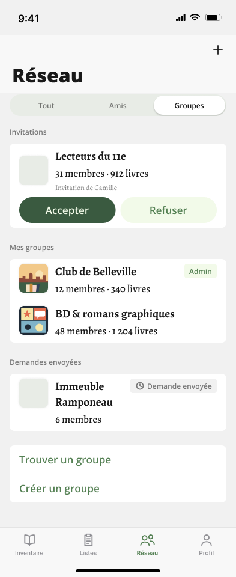

# R6 · Groupes — the Réseau tab, « Groupes » segment

- **Figma node:** `522:16671` "R6 · Groupes" —
  https://www.figma.com/design/S7IvC6GvlcUFe5IgbtvQq6/Nouveau-r%C3%A9cits?node-id=522-16671
- **Section:** "Réseau · Graphe" (`512:15486`), file `S7IvC6GvlcUFe5IgbtvQq6`, page `Screens`. Light mode only.
- **Screenshot:** [`../screenshots/r6-groupes.png`](../screenshots/r6-groupes.png) (393 × 960, 1×)
- **Status:** proposal. Per the spec panel (`515:16039`), R6 is the Groupes list of feature 0028, **unchanged except
  for the photos**.
- **Direct ancestor:** `A2 · Réseau · Groupes` (`501:14278`, section `499:14069`). Same layer tree, same node
  geometry, same copy.



---

## 1. Frame and chrome layout

Frame: 393 × **960**. That is taller than the 852 device, so the content scrolls and the frame is stretched to show it
all. Fill `background/secondary` `#F1F1F1` (`DesignSystem.Color.backgroundSecondary`). The `scroll` frame is the bottom
layer and all chrome is above it.

| Band | Node | x, y | w × h | Notes |
|---|---|---|---|---|
| Status bar | `522:16692` | 0, 0 | 393 × 59 | `Chrome / Status Bar` (`24:30`), Theme=Light |
| Nav bar | `522:16693` | 0, 59 | 393 × 96 | `Chrome / Nav Bar` (`26:162`), Large. Title « Réseau » at x 20 / y 103 (abs). « + » glyph 24 × 24 at x 351 / y 71 |
| Segmented control | `522:16751` | 0, 155 | 393 × 40 | `Chrome / Segmented Control · 3` (`518:510`), **Selected=Right** (« Groupes »). Track 361 × ≈36 at y ≈157 |
| Scroll content | `522:16672` | 0, 211 | 393 × 625 | VERTICAL, gap `spacing/large` 24 |
| Tab bar | `522:16695` | 0, 877 | 393 × 83 | `Chrome / Tab Bar · Réseau` (`498:14327`), Active=Réseau, **no badge** |
| Home indicator | `522:16696` | 0, 926 | 393 × 34 | `Chrome / Home Indicator` (`24:35`) |

The chrome values are byte-identical to R5: status bar, nav bar `rgba(249,249,249,0.94)`, `Title/title200`,
segmented track `background/disable` with padding 2 and radius full, segments with padding 8 and `Action/action200`,
tab bar hairline 0.5 pt `rgba(0,0,0,0.16)`, Inter labels at 10. See
[r5-amis.md §1](r5-amis.md#1-frame-and-chrome-layout). The one difference is the selected segment: « Groupes » (Right)
has the white `background/default` pill with `Shadow/Light` (0, 2, blur 3, `#0000002E`) and a `foreground/default`
label, while « Tout » and « Amis » are `foreground/secondary` text on the `#E8ECE6` track.

---

## 2. Layer hierarchy (exact copy)

```
R6 · Groupes                                FRAME 522:16671   393×960   fill background/secondary
├─ scroll                                   FRAME 522:16672   x0 y211 393×625  VERTICAL, gap spacing/large (24), items centred, clip
│  ├─ section/Invitations                   FRAME 522:16673   y0   393×168  VERTICAL, gap spacing/x-small (4)
│  │  ├─ header                             INSTANCE 522:16674  Section Header (28:164)  Label="Invitations"  Show action=false  393×24
│  │  └─ list group                         FRAME 522:16675   x16 y28 361×140  fill background/default, radius/medium (8), clip
│  │     └─ invitation/Lecteurs du 11e      INSTANCE 522:16676  Cell / Group Invitation (498:14384)
│  │                                          Name="Lecteurs du 11e"  Detail="31 membres · 912 livres"  Invitor="Invitation de Camille"  361×140
│  │        ├─ group                        HStack, gap 12, items CENTER, clip
│  │        │  ├─ Thumbnail (28:163)        Shape=Medium, Size=Medium: 48×48, radius/medium 8, fill background/disable, Shadow/Thumbnail (NO picture)
│  │        │  └─ texts                     VStack, gap spacing/x-small (4), FILL
│  │        │     ├─ "Lecteurs du 11e"      Content/content400Bold, foreground/default
│  │        │     ├─ "31 membres · 912 livres"  Content/content300, foreground/default
│  │        │     └─ "Invitation de Camille"    Footnote/footnote200, foreground/secondary
│  │        └─ actions                      HStack, gap 8
│  │           ├─ Action / Pill (358:357)   Style=Prominent, glyph hidden, FILL — "Accepter"
│  │           └─ Action / Pill (358:357)   Style=Tinted,    glyph hidden, FILL — "Refuser"
│  ├─ section/Mes groupes                   FRAME 522:16677   y192 393×167
│  │  ├─ header                             INSTANCE 522:16678  Section Header  Label="Mes groupes"  393×24
│  │  └─ list group                         FRAME 522:16679   x16 y28 361×139  fill background/default, radius/medium, clip
│  │     ├─ group/Club de Belleville        INSTANCE 522:16680  Cell / Group (498:14383)  State=Admin
│  │     │                                    Name="Club de Belleville"  Detail="12 membres · 340 livres"   361×69
│  │     │  ├─ picture                      48×48, radius/medium 8, Shadow/Thumbnail, image fill (mock illustration)
│  │     │  ├─ texts                        VStack gap 4, FILL, foreground/default
│  │     │  └─ Tag (23:23)                  Tinted, glyph hidden — "Admin"
│  │     ├─ separator                       INSTANCE 522:16681  Separator (47:193)
│  │     └─ group/BD                        INSTANCE 522:16682  Cell / Group  State=Default
│  │                                          Name="BD & romans graphiques"  Detail="48 membres · 1 204 livres"   361×69
│  │        ├─ picture                      48×48, radius/medium 8, Shadow/Thumbnail, image fill (mock illustration)
│  │        └─ texts
│  ├─ section/Demandes envoyées             FRAME 522:16683   y383 393×123
│  │  ├─ header                             INSTANCE 522:16684  Section Header  Label="Demandes envoyées"  393×24
│  │  └─ list group                         FRAME 522:16685   x16 y28 361×95
│  │     └─ group/Immeuble                  INSTANCE 522:16686  Cell / Group  State=Sent
│  │                                          Name="Immeuble Ramponeau"  Detail="6 membres"   361×95
│  │        ├─ Thumbnail (28:163)           Medium/Medium, background/disable (NO picture)
│  │        ├─ texts                        name wraps onto 2 lines: "Immeuble" / "Ramponeau"
│  │        └─ Tag (23:23)                  Secondary, glyph = clock — "Demande envoyée"
│  └─ section                               FRAME 522:16687   y530 393×95   (no header)
│     └─ list group                         FRAME 522:16688   x16 y0 361×95
│        ├─ find                            INSTANCE 522:16689  Row / Link (38:200) Tone=Tinted  Label="Trouver un groupe"   361×47
│        ├─ separator                       INSTANCE 522:16690  Separator
│        └─ create                          INSTANCE 522:16691  Row / Link Tone=Tinted  Label="Créer un groupe"   361×47
├─ status bar                               INSTANCE 522:16692  Chrome / Status Bar  Theme=Light
├─ nav                                      INSTANCE 522:16693  Chrome / Nav Bar  Large, Title="Réseau", action glyph = plus
├─ segmented control                        INSTANCE 522:16751  Chrome / Segmented Control · 3  Selected=Right  "Tout" / "Amis" / "Groupes"
├─ tab bar                                  INSTANCE 522:16695  Chrome / Tab Bar · Réseau  Active=Réseau
└─ home indicator                           INSTANCE 522:16696  Chrome / Home Indicator  Theme=Light
```

All user-facing copy: « Réseau », « Tout », « Amis », « Groupes », « Invitations », « Lecteurs du 11e »,
« 31 membres · 912 livres », « Invitation de Camille », « Accepter », « Refuser », « Mes groupes »,
« Club de Belleville », « 12 membres · 340 livres », « Admin », « BD & romans graphiques »,
« 48 membres · 1 204 livres », « Demandes envoyées », « Immeuble Ramponeau », « 6 membres », « Demande envoyée »,
« Trouver un groupe », « Créer un groupe », « Inventaire », « Listes », « Profil », « 9:41 ».

The detail line uses a middle dot with a space on each side (« · ») as separator, and French digit grouping
(« 1 204 »). The exact space code point (U+0020, U+00A0 or U+202F) cannot be read through the MCP, so it should come
from a number formatter rather than be typed.

---

## 3. Component specs (exact values)

### Cell / Group Invitation (`498:14384`)
Component description: a clone of `Cell / Invitation` with a square thumbnail and a third line naming the inviter (the
membership's `invitor`). Accepter = `PUT /groups/accept`. Refuser = `PUT /groups/decline`, « jamais Destructive ».
- 361 × 140. Padding V 8 (`spacing/small`) / H 16 (`spacing/medium`). Vertical gap **8** (literal = `spacing/small`).
- `group` row: HStack, gap **12** (literal = `spacing/s-medium`), items **centred**.
  - Picture slot: 48 × 48 square, `radius/medium` 8, `Shadow/Thumbnail` (0, 0, radius 4 per Figma, `#0000001A`).
    Here it is **empty**: fill `background/disable` `#E8ECE6`, the Thumbnail pre-load / no-picture state.
  - Texts: VStack gap 4 (`spacing/x-small`), FILL.
    - Name: `Content/content400Bold` (Alegreya Bold 19), `foreground/default` `#191919`.
    - Detail: `Content/content300` (Alegreya Medium 17), `foreground/default`.
    - Inviter: `Footnote/footnote200` (Alegreya Regular 12) → `TextStyle.footnote200`, `foreground/secondary`
      `#00000080`. It sits **inside the text column**, aligned with the name at x = 92 (abs).
- `actions` row: same as `Cell / Invitation`. Two FILL pills, 160.5 × 43 each, padding V 10 (**no token**) / H 16,
  radius full. « Accepter » is Prominent (`#3A5A40` / `#F2FAE9`); « Refuser » is Tinted (`#F2FAE9` / `#558154`),
  label `Action/action300`.
- Height: 8 + 73 (26 + 4 + 23 + 4 + 16) + 8 + 43 + 8 = 140.

### Cell / Group (`498:14383`)
Component description: a clone of `Cell / User`. The thumbnail is a square with `radius/medium` « pour qu'un groupe ne
se lise jamais comme une personne ». Detail = count of admins + members, plus books. States: Default, Admin (Tag
Tinted), Sent (Tag Secondary + clock), Join (Action / Pill Tinted, not used here).
- 361 wide. HStack, gap 12 (`spacing/s-medium`), items **top**-aligned. Padding V 8 / H 16.
- Picture slot: 48 × 48, `radius/medium` 8, `Shadow/Thumbnail`, image cover. Without a picture it shows the
  `background/disable` square.
- Texts: FILL, gap 4. Name `Content/content400Bold` and detail `Content/content300`, both `foreground/default`. The
  name wraps freely: « Immeuble Ramponeau » takes two lines because the tag eats the width, which makes the row 95 tall
  (8 + 26 + 26 + 4 + 23 + 8).
- **Admin** tag (`Tag` 23:23, Tinted): fill `background/tinted` `#F2FAE9`, padding H 8 (`spacing/small`) / V 4
  (`spacing/x-small`), radius `radius/minimal` 4 (`CornerRadius.minimal`). Label « Admin » in `Action/action200`,
  `foreground/tinted` `#558154`. **No glyph.** Top-aligned with the name.
- **Sent** tag (Secondary): fill `background/secondary` `#F1F1F1`. Glyph `clock` 16 × 16 (`sizing/icon/tag` →
  `TagLabelStyle.iconSize`), `foreground/secondary`. Gap 4. Label « Demande envoyée » in `Action/action200`,
  `foreground/secondary`. Same padding and radius as the Admin tag. Top-aligned.
- Default state: no trailing element.

### Section Header, list group card, Separator, Row / Link
Identical to R5; see [r5-amis.md §3](r5-amis.md#3-component-specs-exact-values). In short:
- Header: padding 0/16/8/16, `Action/action200`, `foreground/secondary`, height 24.
- Header to card: 12 (8 + 4).
- Card: x 16, 361 wide, `background/default`, radius 8, clipped.
- Separator: 1 pt `border/default`, inset 16 from the card edge.
- Row / Link: 47 tall, padding 12/16, `Action/action300` `foreground/tinted`, no chevron.
- The last section (« Trouver un groupe » / « Créer un groupe ») has **no header**, so its card starts at the
  section's y = 0.

---

## 4. Absolute positions (layout intent)

| Element | x | y (top → bottom) | size |
|---|---|---|---|
| « Invitations » header | 16 | 211 → 235 | 24 |
| Invitation card | 16 | 239 → 379 | 361 × 140 |
| Lecteurs du 11e thumbnail | 32 | ≈ 259.5 (centred in the 73 pt row that starts at 247) | 48 × 48 |
| Name / detail / inviter | 92 | 247 / 277 / 304 | — |
| Pills | 32 → 192.5 and 200.5 → 361 | 328 → 371 | 160.5 × 43 |
| « Mes groupes » header | 16 | 403 → 427 | — |
| Mes groupes card | 16 | 431 → 570 | 361 × 139 |
| Club de Belleville row / picture / Admin tag | row 16 / pic 32 / tag right-aligned to 361 | 431 → 500 / 439 / 439 | tag ≈ 53 × 24 |
| Separator | 32 → 377 | 500 | 1 |
| BD & romans graphiques row | — | 501 → 570 | 69 |
| « Demandes envoyées » header | 16 | 594 → 618 | — |
| Sent card (Immeuble Ramponeau) | 16 | 622 → 717 | 361 × 95; tag right-aligned at y 630 |
| Find / create card | 16 | 741 → 836 | « Trouver un groupe » 741 → 788, separator 788, « Créer un groupe » 789 → 836 |
| Tab bar | 0 | 877 → 960 | — |

---

## 5. Graph edges and node placement

**Not applicable.** R6 has no graph, edges or positioned nodes. The same groups (Club de Belleville, BD & romans
graphiques, Lecteurs du 11e) appear as graph nodes in R1–R4. There, the spec draws a group invitation as a dashed edge
and uses the `person.2` glyph as the fallback for Lecteurs du 11e. Those values belong to the R1–R4 docs.

---

## 6. Visual states shown

The « Groupes » segment is selected, in light mode. All four sections are populated:
- one received invitation, with its inviter known;
- two of my groups: one where I am Admin (tag), one where I am a plain member (no tag);
- one sent request (tag with clock);
- the two links.

Picture states shown: picture present (Club de Belleville, BD & romans graphiques) and no picture
(`background/disable` square: Lecteurs du 11e, Immeuble Ramponeau).

---

## 7. Interactions the design implies

| Target | Gesture | Outcome (feature 0028 and code; nothing is annotated on the frame) |
|---|---|---|
| « Tout » / « Amis » segment | tap | R1 graph / R5 list |
| « + » (nav) | tap | not restated in Figma. In code it opens the « Créer un groupe » sheet |
| Invitation group block | tap | pushes the group's screen |
| « Accepter » | tap | `PUT /groups/accept`, optimistic. The group moves to « Mes groupes » |
| « Refuser » | tap | `PUT /groups/decline`, optimistic. The row disappears (I move to `declined`) |
| Mes groupes row | tap | pushes the group's screen (member or admin view) |
| Sent request row | tap | pushes the group's screen, where the request can be cancelled |
| « Trouver un groupe » | tap | pushes group search (A4) |
| « Créer un groupe » | tap | creation form (A11 drew a pushed screen; the code uses a sheet) |
| List | scroll / pull | content scrolls under the chrome; pull to refresh (code) |

---

## What changes vs sibling screens

| Compared with | Differences |
|---|---|
| **A2 · Réseau · Groupes** (`501:14278`, feature 0028) | (1) 2-segment « Amis \| Groupes » becomes 3-segment « Tout \| Amis \| Groupes », with « Groupes » now at the right of three. (2) **Club de Belleville and BD & romans graphiques gain group pictures.** In A2 all four thumbnails were the empty `background/disable` square. Lecteurs du 11e and Immeuble Ramponeau stay empty. Nothing else changes: copy, detail lines, tags, order and metrics are identical. |
| **R5 · Amis** | Same chrome. Selected segment Right vs Middle. Square group thumbnails (radius 8) vs round avatars. Taller frame (960 vs 852). Four sections vs two, the last one with no header. |
| **R1–R4 · Tout** | R1–R4 put the graph on white `background/default`. R6 keeps grey `background/secondary` with white cards. The graph's fallback for a group with no picture is the `person.2` glyph (spec panel); R6's list fallback for the same group (Lecteurs du 11e) is a **bare grey square**. |

---

## Not drawn / ambiguous

1. **Book counts in the group detail** (« 340 livres », « 912 livres », « 1 204 livres »). The panel says « inchangées »
   and « rien de neuf côté serveur ». But feature 0028 **deferred** a group's books on purpose: reading them via
   `items/inventory-view?group=` would bring strangers' books into view. The code shows members only. Where would the
   count come from, and does it include non-friends' books?
2. **The Sent row shows « 6 membres » with no book count.** It is unclear whether that is deliberate (not a member, so
   nothing to show) or whether the same rule should apply to the invitation (« 31 membres · 912 livres »), which I am
   not a member of either.
3. **Order inside « Mes groupes »:** Club de Belleville (Admin) is drawn before BD & romans graphiques. The code sorts
   by name, which puts BD first. Is the intent admin-first, or arbitrary?
4. **No-picture fallback:** the list keeps a bare `background/disable` square, while the graph uses the `person.2`
   glyph for the same group. Should the two match?
5. **Tag vertical alignment:** Figma pins the tags to the top of the row (aligned with the name), and the name wraps
   under the tag's width.
6. **Admin tag has no glyph.** `TagLabelStyle` always draws an icon slot. This is the same divergence feature 0028
   already logged for the `Group Header` tags.
7. **Pending dot** (feature 0033, a red dot after the name of a group whose join requests wait on me as admin) is not
   drawn on Club de Belleville, so its position in this design is untested. The tab badge is not drawn either.
8. **Not drawn:** loading (`SyncingInlineRow`), load failure (« Vos groupes n'ont pas pu être chargés. Tirez vers le
   bas pour réessayer. »), empty (A3: « Aucun groupe pour l'instant »), dark mode, an inviter unknown to the store (the
   line is then omitted), the Join state, the pressed and disabled pills, Dynamic Type, VoiceOver.
9. **Segmented band pinned or scrolling**, the default segment, and the « + » target: same open points as R5.
10. **`Shadow/Thumbnail` radius:** 4 in Figma vs 2 in the doc and code, same as R5.

---

## Delta vs current code

Code read: `ReCIT_iOS/Features/Network/GroupsSegmentView.swift`, `NetworkView.swift`, `NetworkSegment.swift`,
`Features/Network/Groups/GroupRowView.swift`, `GroupCellView.swift`, `GroupInvitationRowView.swift`,
`GroupRoleTag.swift`, `PendingDot.swift`, `AppModels/Group/GroupModel.swift`, `Model/Groups/ReaderGroup.swift`,
`DesignSystem/LabelStyles/TagLabelStyle.swift`, `DesignSystem/ButtonStyles/PillButtonStyle.swift`.

| # | Element | Figma (R6) | Code today | Where |
|---|---|---|---|---|
| 1 | Segments, style, placement, default | 3 segments, custom pill track, fixed band; « Groupes » selected | 2 segments, system `.segmented` picker inside the List's first row; default `.friends` | `NetworkSegment.swift:11-13`; `NetworkView.swift:21`, `:27-39` |
| 2 | Group detail line | « 12 membres · 340 livres » / « 48 membres · 1 204 livres » | « 12 membres » only (`groups.members_count`, plural « %lld membre(s) »). `ReaderGroup` carries no book count | `GroupCellView.swift:29`; `ReaderGroup.swift:22-36`, `:60-62`; deferral in `docs/features/0028-network-tab-and-groups.md:111`, `:125-126` |
| 3 | Invitation detail line | « 31 membres · 912 livres » | « 31 membres » | same as #2 (`GroupInvitationRowView.swift:27` → `GroupCellView`) |
| 4 | Inviter line position | inside the text column (x = name's leading), third line of `texts` | a separate line **under the whole cell**, starting at the thumbnail's leading edge: `VStack { GroupCellView; Text(invited_by) }` | `GroupInvitationRowView.swift:26-33` |
| 5 | Invitation: group ↔ actions gap | 8 | `.sMedium` (12) | `GroupInvitationRowView.swift:24` |
| 6 | Invitation: thumbnail alignment | centred against the three text lines | top (`HStack(alignment: .top)`) | `GroupCellView.swift:41` |
| 7 | Pill width and padding | FILL (160.5 each), padding V 10 | hug their labels; padding V `.small` 8 | `GroupInvitationRowView.swift:38-50`; `PillButtonStyle.swift:51-62`, `:53` |
| 8 | Admin tag | « Admin », **no glyph** | `Label("groups.role.admin", systemImage: "checkmark.seal").labelStyle(.tag)`, with a glyph | `GroupRoleTag.swift:16-18`; `TagLabelStyle.swift:39-43` |
| 9 | Tag vertical alignment | top of the row (row items-start) | centred: `GroupRowView`'s `HStack(spacing: .sMedium)` uses the default `.center` | `GroupRowView.swift:16-20` |
| 10 | Sent tag | clock + « Demande envoyée », Secondary | **matches**: `Label("groups.request.sent", systemImage: "clock").labelStyle(.secondaryTag)` | `GroupRoleTag.swift:19-21` |
| 11 | Order in « Mes groupes » | Club de Belleville, then BD & romans graphiques | `localizedStandardCompare` by name, so BD & romans graphiques comes first | `GroupModel.swift:68-76` |
| 12 | Group pictures | photo in a 48 square with radius 8 | already wired: `CellThumbnail(imageUrl: pictureURL, cornerRadius: .medium, size: .medium)`, URL via `APIService.absoluteImageUrl`. Not verified on device | `GroupCellView.swift:42`; `GroupModel.swift:313` |
| 13 | No-picture fallback | bare `background/disable` square | **matches**: `backgroundDisable` under the image, plus a `ProgressView` while loading (not drawn) | `CellThumbnail.swift:57-67` |
| 14 | Thumbnail shadow | `Shadow/Thumbnail` radius 4 (Figma) | `.shadow(color: .black.opacity(0.1), radius: 2)` | `CellThumbnail.swift:71` |
| 15 | Pending dot | not drawn | `PendingDot` (10 pt, `foregroundError`) after the name when `requestsToReview > 0` | `GroupCellView.swift:50-52`; `GroupsSegmentView.swift:79-82`; `PendingDot.swift:16-18` |
| 16 | Tab badge | not drawn | badge = friend invitations + group invitations + requests to review | `MainTabView.swift:84-87`, `:105`; `GroupModel.swift:93-95` |
| 17 | Separators | inset 16 from the card edge, 1 pt `border/default` | system `List` separator; `GroupCellView` sets no `listRowSeparatorLeading` guide, so the `List` default applies | `GroupCellView.swift:40-62` |
| 18 | Chevrons | none | `NavigationLink` on the Mes groupes rows, Sent rows and « Trouver un groupe », so chevrons appear. « Créer un groupe » is a `Button`, so it has none | `GroupsSegmentView.swift:77`, `:95`, `:105`, `:110` |
| 19 | Section order and copy | Invitations → Mes groupes → Demandes envoyées → (no header) Trouver / Créer | **matches**: `groups.invitations` « Invitations », `groups.mine` « Mes groupes », `groups.requests.sent` « Demandes envoyées », `groups.find` « Trouver un groupe », `groups.create` « Créer un groupe », `groups.invited_by` « Invitation de %@ », `network.invitation.accept/refuse` « Accepter » / « Refuser » | `GroupsSegmentView.swift:59-114`; `GroupInvitationRowView.swift:29`, `:39`, `:45` |
| 20 | Inviter missing | always drawn | the line is omitted when the inviter is not in the local `User` store | `GroupsSegmentView.swift:118-122`; `GroupInvitationRowView.swift:28` |
| 21 | « + » | glyph only | `Button("groups.create", systemImage: "plus")` opens the creation sheet | `NetworkView.swift:74-78` |
| 22 | States not in R6 | — | loading / failure / empty state with `EmptyStateView` + « Créer un groupe » secondary button | `GroupsSegmentView.swift:30-57` |
| 23 | Name / detail wrapping | name wraps (2 lines in the Sent row) | name has no line limit (wraps); detail `.lineLimit(2)` | `GroupCellView.swift:46-59` |

Accessibility identifiers to keep: `e2e.network.segment`, `e2e.network.createGroup`, `e2e.group.invitation.accept`,
`e2e.group.invitation.refuse`, `e2e.groups.find`, `e2e.groups.create`, `e2e.groups.create.empty`, `e2e.groups.pending`.

---

## Token map (values specific to R6; the rest are as in R5)

| Figma variable / style | Value | Swift symbol |
|---|---|---|
| `background/disable` (empty picture) | `#E8ECE6` | `.backgroundDisable` |
| `background/tinted` (Admin tag, Refuser) | `#F2FAE9` | `.backgroundTinted` |
| `background/secondary` (Sent tag, screen) | `#F1F1F1` | `.backgroundSecondary` |
| `radius/minimal` (tags) | 4 | `CornerRadius.minimal` |
| `radius/medium` (group picture, cards) | 8 | `CornerRadius.medium` |
| `sizing/icon/tag` (clock glyph) | 16 | `TagLabelStyle.iconSize` (`@ScaledMetric`) |
| `Footnote/footnote200` (inviter line) | Alegreya Regular 12, line height auto, letter spacing 0 | `TextStyle.footnote200` |
| `Action/action200` (tags, segments, headers) | Open Sans SemiBold 12 | `.action200` |
| `Shadow/Thumbnail` | `shadow/soft` `#0000001A`, 0/0, radius 4 (Figma) | **no Swift token** (literal, radius 2) |
| `Shadow/Light` (selected segment) | `shadow/light` `#0000002E`, 0/2, blur 3 | `DesignSystem.Shadow.light` |
| Pill vertical padding | 10 | **no token** |
